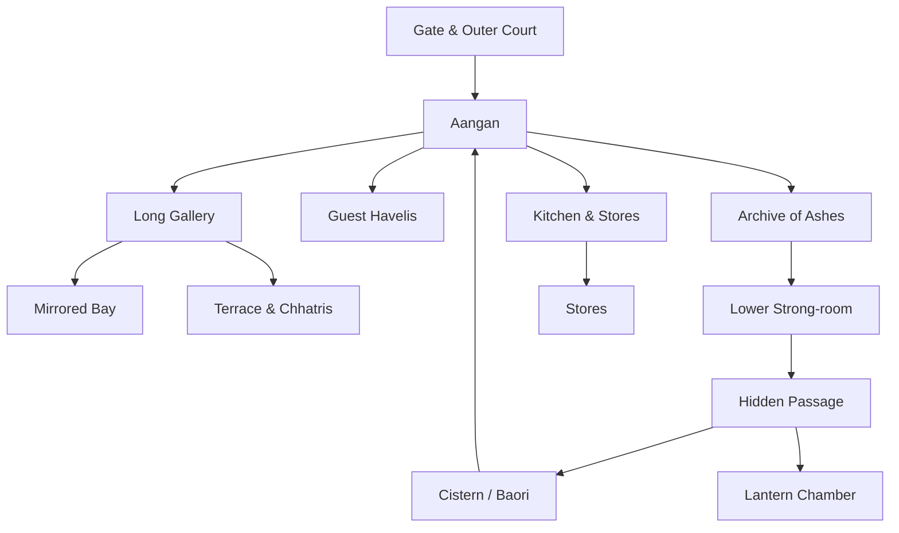

# ARCHITECTURE REFERENCE — THE LAST LANTERN

> Depends on: `00-DESIGN_CANON.md`, `ART_DIRECTION.md`.
> Feeds: `ASSET_MANIFEST.md`, `CINEMATIC_STORYBOARD.md`, `TECHNICAL_ARCHITECTURE.md`.

## 1. Purpose and honesty statement

This document separates **what is grounded in real Rajput architecture** from **what is
invented for the game**. Nimbagarh is fictional. It is not, and must never be presented as,
an exact reconstruction of Suryagarh Palace or any other real property. The build uses real
architectural principles and real reference photography as *inspiration and material study*,
then invents a playable layout.

The honest engineering claim is: **"a fictional palace built from researched Rajasthani
architecture, with Suryagarh Palace as the primary massing and material reference."**

## 2. Reference set (provenance in `ASSET_MANIFEST.md`)

| Reference | What it teaches | Licence status |
|---|---|---|
| Suryagarh Palace, Jaisalmer (official site, archived) | massing, verandahs, turrets, haveli suites, courtyards, desert hospitality light | no asset reuse; factual/visual study only |
| Jaisalmer Fort and Raj Mahal | sandstone massing, bastions, palace court hierarchy | Wikimedia Commons images where used, with credit |
| Patwon ki Haveli, Nathmal ki Haveli, Jaisalmer | facade articulation, jharokhas, jali, painted ceilings | Wikimedia Commons images where used, with credit |
| Rajput architecture (general) | cusped arches, chhatris, brackets, carved stone | public-domain scholarship and CC images |
| Architecture of Rajasthan | stepwells, taanka, jali screens, arid-climate logic | public-domain scholarship and CC images |
| Māru-Gurjara temple detail | ceiling rosettes, carved columns, recessed bands | CC images; used for texture study, not copied as ritual spaces |

**Explicitly not used:** reality-show sets, logos, clips, contestants, soundtrack, branded
furniture, or any photograph whose licence does not allow commercial use.

## 3. Real architectural vocabulary to model

These are grounded, identifiable features that give the palace its authenticity. Each is a
modular kit piece with a material and an LOD.

| Feature | Description | Gameplay role |
|---|---|---|
| **Aangan** (central courtyard) | open-to-sky court, fountain or baori, surrounding arcade | social hub, mission staging, Lantern location |
| **Verandah / baradari** | colonnaded covered walk around the court | room connector, conversation space |
| **Jharokha** | projecting oriel window with a small roof and brackets | overlook, private view, dossier frame |
| **Jali** | pierced stone screen, geometric or floral | light pattern, hidden sightline, transition mask |
| **Chattri** | domed pavilion on columns | rooftop landmark, ceremony point |
| **Cusped / scalloped arch** | multi-cusped opening | doorway, gallery rhythm |
| **Carved column** | faceted shaft, bracket capital, base moulding | structure and shadow |
| **Bracket (toda/toka)** | angled stone support under eaves and balconies | silhouette detail |
| **Chhajja** | overhanging eave on brackets | shade line, shadow drama |
| **Plinth and step (aangan steps)** | broad low platforms | navigation, seated conversation |
| **Brass and mirror-work** | studded doors, vessels, sheesh fragments | material accents, puzzle mirrors |
| **Taanka / baori** | covered underground tank / stepped well | cistern mission, hidden room |
| **Fresco / lime plaster** | pigment on plaster, worn by weather | archival decoration, clue surfaces |
| **Stone lattice parapet** | low pierced wall at roof edges | rooflines, safe boundaries |
| **Wooden door with brass studs** | heavy double door, latch, lock plate | room transition, sabotage target |

## 4. Fictional rooms invented for the game

Each room is marked **grounded** (uses real vocabulary) or **fictional** (layout/function
invented). All share the same material language.

### 4.1 The Aangan (courtyard) — **grounded massing, fictional layout**
- Open court, 28 m × 22 m, surrounded by a two-storey arcade on four sides.
- Centre: a low octagonal fountain and the **Last Lantern** on a carved plinth, ringed by
  twelve seats for council.
- Corners: four principal doors — north to the Long Gallery, east to the Guest Havelis,
  south to the Gate, west to the Archive. The Kitchen is reached by a service stair off the
  east arcade, not a fifth ceremonial door.
- Ground: large sandstone flags with wear paths; a shallow water channel crosses the court.
- Lighting: direct desert sun by day; at night, four oil practicals and the Lantern.
- Gameplay: social hub, council by dusk, mission staging, room-state anchors (fountain on/off,
  Lantern height).

### 4.2 The Long Gallery — **grounded (colonade) + fictional (length and mirrored bay)**
- 46 m colonnaded gallery, 6 m wide, cusped arches on the court side, jali screens on the
  outer side.
- Twelve portrait niches, one per contestant, updated by the engine as they are eliminated.
- A mirrored bay near the centre houses the **Gallery of Mirrors** puzzle.
- Jali casts a moving lattice across the floor; the pattern changes with the time of day.
- Gameplay: navigation spine, reflection puzzle, private conversation nooks.

### 4.3 The Archive of Ashes (archive and scriptorium) — **fictional function, grounded detail**
- Two levels: a scriptorium with writing desks and a lower strong-room behind a carved door.
- Shelves of ledgers, rolled manuscripts, sealed chests, a broken seal plate.
- The **cut seal** clue is found on the door frame.
- A hidden passage (invented) connects the lower strong-room to the cistern.
- Gameplay: evidence sorting mission, major documentary clues, backstory reveals.

### 4.4 The Council Chamber (darbar) — **grounded massing, fictional furnishings**
- A raised dais with the host's seat; a round brass table is the game's invention.
- Mirror-work ceiling fragments catch the Lantern flame.
- Jali screens on three walls create moving shadow patterns during arguments.
- Twelve floor positions, one per contestant; eliminated seats are covered with cloth.
- Gameplay: council, final vote, the Last Question.

### 4.5 The Guest Havelis (private quarters) — **grounded haveli form**
- A row of small suites off a secondary courtyard, each with a bed, a wash niche, a jharokha,
  a writing table and a personal object belonging to the occupant.
- Each room is a clue site: personal objects reveal motive and contradiction.
- The player's room is the save point and the Journal's diegetic home.

### 4.6 The Cistern (baori / taanka) — **grounded water logic, fictional lock puzzle**
- A stepped well with a water channel and three visible lock wheels, plus one hidden valve.
- Rich in echo; audio carries across rooms, creating eavesdropping opportunities.
- Gameplay: Cistern Locks mission, sabotage target, flooded lower archive state.

### 4.7 The Lantern Chamber — **fictional**
- A small octagonal room under the Aangan, reached from the Archive hidden passage.
- The Last Lantern's source: a fire vessel, oil stores, twelve brass wicks, and a ledger of
  every previous keeper.
- Gameplay: finale location, optional reveal, "what would you trade the flame for" question.

### 4.8 The Kitchen and Stores — **grounded function**
- Open hearth, spice shelves, copper vessels, a courtyard herb bed.
- The kitchen is a social listening post; sounds carry into the gallery.
- Gameplay: poison clue, alibi source, Kabir's home ground.

### 4.9 The Terrace and Roofline — **grounded chhatris, fictional access**
- A walkable roof with chhatris, parapets and views of the desert and the city.
- Used for private conversations and one optional clue (a signal light seen at night).
- Gameplay: quiet talks, a vantage point, a danger of being seen.

### 4.10 The Gate and Outer Court — **grounded**
- The arrival point; the prologue's threshold. Heavy doors, brass studs, guard niches.
- Gameplay: prologue, escape-route red herring, a place where someone could have left.

## 5. Room relationship diagram

## 6. Dimensional and production notes

- **Scale:** 1 unit = 1 metre in Blender and in-engine. Eye height 1.65 m, corridor width
  3.6 m, arch height 4.2 m, gallery 6 m wide, courtyard 28 × 22 m.
- **Sightlines:** from the Aangan, at least three distant landmarks must be visible (a
  chhatri, a jharokha, a jali screen) so the player can orient without a minimap.
- **Modular kit grid:** 3 m wall module, 1.5 m sub-module, 0.3 m trim grid.
- **Doors:** 2.4 m × 1.2 m double doors; 2.1 m × 0.9 m single doors.
- **Rooms per load:** the palace is one scene divided into 14 streaming zones (10 named rooms
  plus four sub-zones: strong-room, hidden passage, mirrored bay, cellars); each zone loads its
  models, textures and audio beds on approach behind a jali transition.
- **Collision:** walkable floors and ramps only; steps are ramps with invisible collision;
  water is a boundary except in scripted events.
- **Occlusion:** portals between rooms; a room's contents are culled until its portal is in
  view. The gallery's colonnade is a natural occluder.

## 7. Material and lighting references per room

| Room | Key material | Key light | Time-of-day change |
|---|---|---|---|
| Aangan | sandstone flags, water, brass | direct sun / four oil lamps | strong: sun angles across the court |
| Long Gallery | carved sandstone, jali, mirror | raking sun through jali | strong: lattice pattern travels |
| Archive | wood, paper, dust | single oil lamp, one high jali | moderate: dust motes |
| Council | brass, mirror-work, textile | Lantern + mirror fragments | strong: mirror shards move with flame |
| Havelis | lime plaster, textile, wood | jharokha daylight, lamp | moderate |
| Cistern | wet stone, water, moss | reflected light from above | weak, eerie |
| Lantern Chamber | fire vessel, brass, oil | the flame itself | the flame is the light |
| Terrace | sandstone, sky | moon / sun, one signal light | strong |

## 8. What can be grounded in photography

These are the elements the team can look at real, licensed photographs to model faithfully:

1. Sandstone colour range and weathering (ochre to rose to grey in shadow).
2. Jali geometries: geometric star-and-cross, floral, and calligraphic-form screens.
3. Jharokha construction: bracket, sill, small roof, finial.
4. Cusped arch profiles and the depth of the reveal.
5. Chhatri proportions: column height to dome radius.
6. Chhajja overhang and bracket spacing.
7. Courtyard paving patterns and wear paths.
8. Brass door studs, latch plates and lock forms.
9. Stepwell stair geometry and water line.
10. Mirror-work fragment sizes and setting patterns.

These cannot be grounded and must be invented honestly: the exact building plan, the hidden
passages, the Lantern Chamber, the mirrored puzzle bay, the round council table, and every
room's furniture layout for gameplay.

## 9. Modelling checklist per module

- [ ] Grey-box at correct scale, reviewed against a human reference.
- [ ] Real-world proportion checked (column order, arch rise, bracket depth).
- [ ] UVs planar/trim-friendly; a 1 m and 0.25 m reference checked in-engine.
- [ ] PBR set: albedo, normal, roughness, AO, metallic; correct sRGB/linear handling.
- [ ] LOD0 / LOD1 / LOD2 with measured triangle and draw-call budgets.
- [ ] Collision hull authored separately and tested with the player capsule.
- [ ] Lightmap UVs non-overlapping; baked in the lighting pass.
- [ ] Licensed source recorded in `ASSET_MANIFEST.md` with attribution.
- [ ] Screenshot at 1440p and 390px reviewed against `ART_DIRECTION.md`.

## 10. Common architecture mistakes this project must avoid

- **Primitive palace:** boxes with a sandstone colour. Banned.
- **Ritual spaces as décor:** modelling an active temple as a puzzle room. Temples may be
  referenced for craft, never staged as play spaces.
- **Orientalist pastiche:** mixing Rajasthani, Mughal and fantasy-Indian motifs without
  research, or treating the palace as "exotic" rather than inhabited.
- **Duplication without variation:** the same arch repeated for 46 m with no change in
  light, damage or function.
- **Wrong water logic:** a desert palace with unlimited water and no cistern, tank or
  channel. Water is scarce and engineered; the cistern mission depends on this.
- **Detail without budget:** high-poly carving on every surface. Use normal maps and trim
  sheets; reserve geometry for hero pieces (the Lantern, the main jali, the council table).
