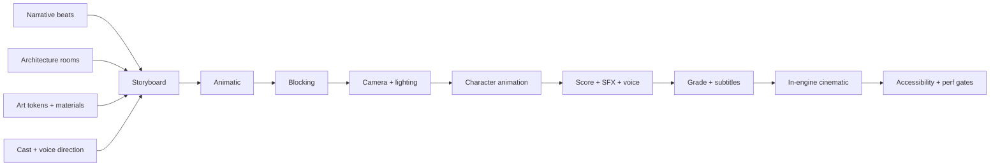

# CINEMATIC STORYBOARD — THE LAST LANTERN

> Depends on: `00-DESIGN_CANON.md`, `NARRATIVE_AND_CHARACTERS.md`, `ART_DIRECTION.md`,
> `ARCHITECTURE_REFERENCE.md`.
> Feeds: `UI_SCREEN_SPEC.md`, `TECHNICAL_ARCHITECTURE.md`, `ASSET_MANIFEST.md`.

## 1. Cinematic principles

1. **In-engine first.** Every cinematic is played in the real scene at real materials so the
   player never sees a quality drop between cut-scene and play. Pre-rendered footage is used
   only if a shot is impossible in real time and is labelled as such.
2. **Skippable, subtitled, transcripted.** Every cinematic has skip, pause, subtitle size,
   transcript and a summary card that enters the Journal.
3. **One take, one idea.** Each shot carries a single piece of information. If a shot can be
   cut without losing meaning, cut it.
4. **The flame is the clock.** The Lantern Meter appears diegetically in every cinematic as
   the light source, so the player always knows how much time is left.
5. **No motion-only information.** Nothing important is conveyed by camera movement alone.
6. **Reduced motion** replaces travel with cuts, and scrubbed sequences with static frames.

## 2. Shot grammar

| Element | Convention |
|---|---|
| Lens | 24–35 mm architecture, 50–85 mm portraits, 100 mm+ desert |
| Camera move | slow dolly, crane, or locked-off; no handheld shake except a scripted alarm |
| Cut | on a sound (bell, latch, breath) or on a light change |
| Transition | **jali close** (lattice closes over frame), **flame wipe** (a flame passes), **door iris** (a doorway swallows frame), **sand dissolve** |
| Colour | warm mid-tones, indigo shadows; grade shifts colder as the Lantern drops |
| Grain | fine, static, 4–6% |
| Overlay | chapter title in Fraunces, lower third only, never over a face |

## 3. Opening sequence (shot list)

**Runtime target:** 3:20. **Scene:** external drift → gate → Aangan → gallery → oath → night.

| Shot | Dur | Frame | Camera | Action | Audio | Notes |
|---|---|---|---|---|---|---|
| O1 | 10 s | black | locked | a match strikes; flame appears in a brass lantern | match, breath | no title |
| O2 | 22 s | desert horizon | slow crane up | palace resolves from haze; birds scatter | strings enter; caravan bell | LOD bias to highest |
| O3 | 14 s | gate | slow dolly in | carved door; brass studs; an emblem of a flame | gate groan | silhouette of a servant |
| O4 | 18 s | Aangan | crane down | fountain, arcade, four doors, the Lantern lit | water, host speaks line 1 | Lantern is the focal light |
| O5 | 28 s | gallery | lateral track | eleven AI portrait niches; the player's niche stays dark | percussion per name | each portrait renders live |
| O6 | 18 s | oath table | locked, shallow focus | twelve hands, brass cups, one flame | oath language | no faces yet |
| O7 | 16 s | gallery | slow push | the host walks; jali light crosses his face | footsteps, cloth | introduces the six nights |
| O8 | 20 s | Aangan | slow orbit | the twelve stand in a ring; the Lantern flares | flare, wind | first full cast shot |
| O9 | 14 s | corridor | dolly, lights fail | one corridor light dies; a chair scrapes | wind, scrape | cut on dark |
| O10 | 18 s | archive door | locked | dawn; the seal is cut; a page is missing | silence, then host line | the first clue |
| O11 | 14 s | Aangan | slow pull back | title: THE LAST LANTERN / Every oath has a shadow. | theme resolves | title card |
| O12 | 8 s | player POV | hand-off | the player takes control; HUD fades in | ambience | tutorial begins |

**Opening interactivity rules:** skip is available from O2; the transcript is written at the
end; a missed shot is recoverable from the Journal's "The Summons" entry.

## 4. Chapter cards

Each chapter opens with a 6–10 second card: a single architectural detail, the chapter title
in Fraunces, and the night number. No voice-over. The card is the transition, not a screen.

| Chapter | Card image | Title |
|---|---|---|
| 1 | lantern lit in the Aangan | The Summons |
| 2 | a jali shadow on an empty chair | The First Shadow |
| 3 | a cracked mirror fragment | The Broken Gallery |
| 4 | ash on an open ledger | The Archive of Ashes |
| 5 | water rising over a step | The Cistern |
| 6 | the flame at its lowest | The Last Lantern |

## 5. Dawn briefing sequences

- **Dawn 1–5:** 20–35 seconds. The camera wakes in the player's haveli, moves through the
  jharokha to the Aangan, and settles on the Lantern. The host's voice gives: last night's
  result, today's mission, and one rumour.
- **Judgment of the Flame** is the emotional beat: the camera holds on the covered chair of
  the eliminated contestant, then the cloth is drawn back, and the role is revealed as a
  carved brass disc that turns over. Oathkeeper or Shadowed. 8–12 seconds.
- **Reduced motion:** static frames with the same information and an immediate text card.

## 6. Mission cutscenes

Each mission has a 12–20 second intro and an 8–15 second outcome.

| Mission | Intro shot | Outcome shot |
|---|---|---|
| Archive Ledger | torn pages drift on a desk; a lamp gutters | the ledger is sealed, or a clean-cut edge is discovered |
| Gallery of Mirrors | jali light crosses three mirrors; an inscription bleeds through | the inscription resolves, or burns away |
| Cistern Locks | water trembles in a dark well; a wheel turns | the reservoir steadies, or a hidden valve is found greasy |

The **secret Shadow objective** is never shown in a cutscene, so a viewer who is not Shadowed
cannot learn it from the intro.

## 7. Veiling sequence (night removal)

The Veiling is the game's violence, and it is absence, not gore.

1. **The last conversation** (0–10 s): the camera holds on the contestant's last public
   moment, replayed from the day.
2. **The corridor** (4–8 s): a lamp goes out at the far end; a door is half-open; no body.
3. **The empty room** (6–10 s): the bed is made, the jharokha is open, the personal object
   is gone. The Lantern Meter drops.
4. **The chair** (4 s): the council chair is covered with cloth.

No blood, no weapon, no scream on screen. Sound: wind, a latch, a flame guttering.

## 8. Council and finale cinematics

### 8.1 Council open
- 8 seconds. The hall darkens; the round table catches the Lantern; each living contestant
  is briefly lit as their name is read.

### 8.2 Vote count
- 10–18 seconds, varies with the number of votes. Brass discs drop one by one onto the table;
  the camera cuts to the named contestant at each drop. Tie triggers the **Lantern's Riddle**
  card.

### 8.3 The Reckoning (the last survivors)
- 40–70 seconds. Each survivor gives one uninterrupted testimony. The camera is a slow dolly
  from one face to the next; the background is a single flame.

### 8.4 The Last Question (the last survivors)
- 20–30 seconds. The host asks each survivor: *"What would you trade the flame for?"* One
  static portrait per answer; the answer updates the trust model and is stored for the epilogue.

### 8.5 The Unmasking
- 30–45 seconds or interactive. The camera orbits the table as each role, pact and lie is
  revealed as a carved disc and a ledger line. The player can step through at their own pace
  (accessibility: fully interactive, no autoplay).

## 9. Ending cinematics

Each is 20–45 seconds and ends on the title mark.

| Ending | Final image | Last line |
|---|---|---|
| The Keeper of the Flame | dawn over the Aangan; the flame steady; the player's hand on the Lantern | "The flame keeps what the oath began." |
| The Quiet Steward | an empty chair at a lit table | "Some keep the flame by leaving it room to burn." |
| The Shadow's Lantern | a cold blue flame; the palace in mist | "The dark was never the enemy. It was the room." |
| The Gilded Betrayal | a broken Pact seal on the table; the flame low | "You were not lied to. You were believed." |
| The Long Dark | black; one ember; wind | "The Last Lantern did not fail. It was finished." |
| The Unlit Oath | two covered chairs; a tied vote ledger | "No one won. Everyone swore." |

## 10. Transitions catalogue

| Transition | Use | Duration | Reduced-motion |
|---|---|---|---|
| Jali close | entering/leaving a chapter or a private space | 700 ms | cut |
| Flame wipe | moving between time of day | 600 ms | cut |
| Door iris | entering a room in-engine | 500 ms | cut |
| Sand dissolve | location change over distance | 800 ms | cut |
| Brass turn | role reveal / Judgment | 900 ms | static disc + text |

## 11. Subtitles and accessibility

- Subtitles on by default, positioned in the lower safe area, with a solid tone scrim.
- Sizes: S / M / L / XL; speaker names always shown; sound effects in [brackets].
- Full transcript available from pause and from the Journal after each chapter.
- Audio clues are paired with visual equivalents in cinematics and in play.
- `prefers-reduced-motion` swaps all camera travel for cuts and disables parallax, flame
  flicker and scrubbed sequences; every frame still carries its information.
- No cinematic contains a flash faster than 3 Hz; the flame never strobes.

## 12. Production pipeline and dependencies

1. **Animatic** in-engine with grey-box geometry and placeholder voice. Reviewed against this
   shot list before any final animation.
2. **Blocking** with the real characters, real camera rigs and real lighting.
3. **Performance capture or hand-key** per shot; facial animation to visemes; body animation
   from a documented source (see `ASSET_MANIFEST.md`).
4. **Audio**: original score and sound design; voice recorded with documented talent and
   consent; no cloning of real people.
5. **Grade and grain** applied in-engine with a shared LUT so cinematics and play match.
6. **Subtitles and transcript** authored in the same pass; never after shipping.
7. **Budget check**: each cinematic must fit its render budget on the medium quality tier.
   If it does not, simplify the shot, not the story.

## 13. Dependency map

