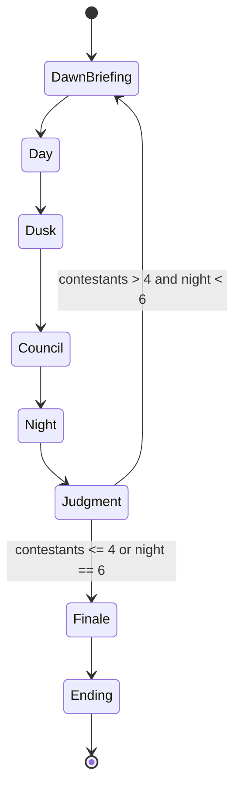

# GAME DESIGN — THE LAST LANTERN

> Depends on: `00-DESIGN_CANON.md`, `PRODUCT_VISION.md`.
> Feeds: `AI_BEHAVIOUR_SPEC.md`, `UI_SCREEN_SPEC.md`, `TECHNICAL_ARCHITECTURE.md`,
> `ACCEPTANCE_CRITERIA.md`.

## 1. Design statement

A 12-contestant social-deduction game with a physical palace, a dying flame and a delayed
role reveal. The players argue, investigate and vote by day; the Shadowed veil and sabotage
by night; the Lantern Meter measures how much of the palace's truth is still lit.

**Design target:** a first-time player understands the goal in 5 minutes, plays a complete
night in 6–10 minutes, and a typical full session in 25–40 minutes. A full six-night match may
run to about 60 minutes.

## 2. Nouns and verbs

| Noun | Meaning |
|---|---|
| Contestant | Any of the 12 participants (1 human + 11 AI) |
| The Lantern | The ancestral flame; its meter is the shared resource |
| Lantern Meter | 0–120 shared value; 0 ends the game (Shadow win) |
| Ember | Currency earned in missions; spends on Shields, hints, private channels |
| Testimony | A recorded statement by a contestant, usable as evidence |
| Evidence | A physical or documentary clue found in the palace |
| Veil | The Shadowed's ritual removal of a contestant, attempted on Nights 1, 3 and 5 |
| Ward | The Warden's nightly protection against a Veil |
| Read the Flame | The Keeper's nightly investigation of one contestant |
| Oath Shield | Consumable immunity to one elimination vote |
| Pact | A named agreement between two contestants with terms |
| Council | The dusk vote; the only way to eliminate a contestant |
| Testament | The final statement of an eliminated contestant |
| Judgment of the Flame | The next-morning reveal of an eliminated contestant's role |

Verbs the player performs: **explore, examine, question, confide, promise, deceive, accuse,
defend, present, vote, ward, read, veil** (the last three only if their role allows).

## 3. Victory and defeat

| Result | Condition |
|---|---|
| **Oathkeeper victory** | Every Shadowed is eliminated (by council vote or scripted finale) |
| **Shadow victory (parity)** | Living Shadowed ≥ living Oathkeepers |
| **Shadow victory (darkness)** | Lantern Meter reaches 0 at any time |
| **Finale decision (last four)** | With at least one Shadow alive when the finale begins, the final council names one contestant. If they are Shadowed, Oathkeepers win. If they are an Oathkeeper, Shadowed win. |
| **Draw / bittersweet ending** | A second tied final vote produces the *Unlit Oath* ending, scored as a Shadow win with an epilogue variation |

The player's personal ending (which of six doors) depends on their faction, their survival,
their broken or kept oaths, and the final vote.

## 4. Match setup

1. **Seat 12.** The engine creates 12 contestant slots. The player occupies one.
2. **Assign roles** with a seeded shuffle, independent of personality: 3 Shadowed, 1 Lantern
   Keeper, 1 Warden, 7 Oathkeepers.
3. **Assign private motives** to each AI (fixed per character, role-independent).
4. **Place evidence** from the level's clue pool using the seeded RNG. No two games place
   the same clues in the same rooms.
5. **Set the Lantern Meter** to 100.
6. **Deal opening alibis**: each contestant receives a private first-night account of where
   they were at a fixed hour. Some accounts are false; the engine records truth privately.
7. **Seal the oath.** The player receives a private card naming their role, faction and night
   action (if any). The card is visible only to the player; it is never shown on a shared
   surface or to an AI.
8. **Begin Dawn 1 briefing.**

### 4.1 Role assignment rules

- The player may be any of the four roles. The creation screen never hints at the assignment.
- The same character cannot hold the same role in two consecutive New Games on the same save
  file (soft anti-repeat; overridden by "fully random" setting).
- Shadowed teammates are drawn by the same seeded shuffle as every other role. The engine does
  not use social bonds, personality or dossier to choose them; the drama comes from how the
  drawn team handles its differences.

## 5. The round loop

Each round is one night. The festival calendar allows **up to six nights**; a match ends
earlier if the Lantern reaches 0, parity is reached, or the finale trigger is met. The finale
replaces the last round's council. The expected shape is 4–5 nights and 25–40 minutes of play;
a full six-night match may run to about 60 minutes. The six chapters in
`NARRATIVE_AND_CHARACTERS.md` are the full-calendar spine. If a match resolves early, the
remaining chapter reveals are folded into the Unmasking and the ending epilogue rather than
silently skipped.

### 5.1 Dawn Briefing

- Cinematic: the flame, the night's result, the day's mission.
- **Judgment of the Flame** reveals the role of every contestant eliminated since the
  previous Dawn — council and Veil alike.
- The Lantern Meter tick (−10) is applied once at Dawn and shown as a diegetic burn-down.
  Every Lantern change is a ledger entry with a reason; the same change is never applied twice.
- The player receives a private reminder if their role has a night action.

### 5.2 Day

Three interleaved activities. The player chooses; the world continues.

1. **Missions** (2 per day, 3–5 minutes each). Cooperative puzzles with a shared objective
   and a hidden Shadow sabotage opportunity. Rewards: Embers, Lantern, Testimony.
2. **Exploration and investigation.** Walk the palace, examine objects, find Evidence.
   Rooms have state: doors, lights, water, damage from sabotage.
3. **Society.** Approach any living contestant for a conversation, a pact, a trade or a lie.

Day ends when the player triggers the bell at the Aangan, or when the daylight timer expires
(10 real minutes by default; configurable; can be set to untimed in accessibility settings).

### 5.3 Dusk

A short, private phase:
- The player reviews the Journal and Evidence Board.
- The player may send one **private note** to one contestant (optional).
- AI contestants rearrange their beliefs and decide their council posture.
- The **Pact Ledger** is shown: active promises, debts and betrayals.

### 5.4 Council

1. **Opening statement** by the host; the Lantern is dimmed.
2. **Speak** — each living contestant gets one floor turn. The player chooses an intent:
   accuse, defend, present evidence, question, stay silent.
3. **Cross-talk** — AI reacts to what was said, adjusting suspicion and trust in public.
4. **Vote** — simultaneous, locked. The player's vote is explicit. Shields may be spent
   before the count.
5. **Count** — the host reads the tally with shields applied. The highest remaining tally is
   eliminated; a tie triggers the Lantern's Riddle. A shield cancels one vote against its
   holder (maximum two held); if every tally is reduced to zero, no one is eliminated and the
   Lantern loses 10.
6. **Tie** — **Lantern's Riddle**: 30 seconds of open cross-talk, then a re-vote among the
   tied. A second tie means no elimination and the Lantern loses 15.
7. **Testament** — the eliminated contestant gives a final statement (may contain a lie,
   a truth, or a clue). They leave play but remain in the Journal and can appear in
   flashbacks.

### 5.5 Night

- **Shadowed:** on **Veil nights (1, 3, 5)** the three open a private channel and choose a
  Veil target and optionally one Sabotage. On **Vigil nights (2, 4)** they may only choose one
  Sabotage. If the target is Warded, the Veil fails and the rite is spent; the Shadowed learn
  the Ward exists but not who cast it. Sabotage is chosen from the map's sabotage table for the
  current chapter. Night 6 has no Veil; it is the finale.
- **Lantern Keeper:** choose one living contestant to Read. Result is private and exact:
  *Shadowed* or *Oathkeeper*. A Sabotage named *The Smoke* may return *Clouded* once.
- **Warden:** choose one living contestant to Ward. Cannot ward self. Cannot ward the same
  person on consecutive nights.
- **Oathkeeper:** no action; may review the Journal and set a private intention for the AI
  that will act on their behalf in quick-resolve mode.
- The player sees only their own action screen. Other night actions are resolved in the
  engine and narrated at dawn.

### 5.6 Judgment

- If a Veil occurred, the result is narrated (who left, what was found).
- Every elimination since the previous Dawn (council and Veil) is revealed by the Judgment of
  the Flame.
- The Lantern Meter is updated.
- If the Lantern is at 0, go to the *Long Dark* ending.

## 6. Missions

Three mission families ship in the baseline. Each family has three variants, and each variant
has a **public objective** and a **secret Shadow objective**.

### 6.1 The Archive Ledger (evidence sorting)

- **Objective:** reconstruct a torn ledger of palace stores. Drag fragments into a timeline.
- **Cooperative value:** fragments are scattered across the room and can be called out by
  other contestants.
- **Shadow objective:** quietly remove one true fragment before the ledger is sealed.
- **Reward:** +10 Lantern, 1 Ember each, one Testimony about palace stores.
- **Failure:** +0 Lantern; a false entry enters the record as a red herring.
- **Tell:** a missing fragment leaves a *clean cut* on the seal — later examinable evidence.

### 6.2 The Gallery of Mirrors (light and symbol puzzle)

- **Objective:** align three mirror assemblies and a jali shutter to reveal an inscription
  on the far wall.
- **Cooperative value:** each mirror needs one contestant to hold it; the alignment is read
  aloud by another.
- **Shadow objective:** tilt one mirror to reveal a different (planted) inscription.
- **Reward:** +15 Lantern, one major Evidence (a name, a date, or a map fragment).
- **Failure:** the inscription is burned by focused light, losing the clue.
- **Tell:** the planted inscription uses a symbol from a different century.

### 6.3 The Cistern Locks (valve and water puzzle)

- **Objective:** balance three cistern locks so the palace reservoir does not overflow.
- **Cooperative value:** two people must work remote valves while one reads the pressure.
- **Shadow objective:** open a fourth hidden valve, draining the reservoir and flooding the
  lower archive.
- **Reward:** +20 Lantern, +1 Oath Shield for the leading contributor.
- **Failure:** −10 Lantern, the Archive is flooded and one clue is permanently lost.
- **Tell:** the hidden valve has fresh grease and a Shadowed cipher mark (examinable).

### 6.4 Scarcity and fairness

- A contestant can contribute at most twice per mission; the game rotates contributions so
  one player cannot farm all Embers.
- AI contribution is driven by personality (Nerve, Curiosity, Guile) and by current suspicion.
- If the player is Shadowed, the secret objective is presented as a normal mission step with
  a private "optional" marker, never as a prompt that says "sabotage now."

## 7. Evidence and investigation

### 7.1 Evidence types

| Type | Source | Example | Board use |
|---|---|---|---|
| **Physical** | Examine objects | A clean-cut ledger fragment; a grease smear | Can be *shown* to a contestant to see their reaction |
| **Documentary** | Archive, ledgers, letters | A guest list with a name scraped off | Can be *matched* to Testimony |
| **Testimony** | Conversations and confessions | "I was in the kitchen at the second bell" | Can be *contradicted* by Physical or Timeline |
| **Timeline** | Observation of movement | "Zoya left the gallery before the light went out" | Anchors contradictions |
| **Cipher** | Shadow objects or marks | A carved symbol on a valve | Unlocks a hidden chamber or a named suspect |

### 7.2 The Evidence Board

A node graph the player builds. Evidence, Testimony, people and rooms are nodes; the player
draws links (supports, contradicts, places, suspects). The board never auto-solves; it only
stores the player's reasoning. The engine uses the board to weight the player's accusation
credibility when AI evaluates what the player says.

### 7.3 Clue integrity rules

- Every clue has a **truth state** (true / false / planted) known only to the engine.
- A clue is **discoverable** only if the player or an AI reaches its location in the correct
  room state (e.g., after the cistern is drained).
- No clue is generated by an LLM. All clues are authored and validated by Zod.
- At least one clue per night must point, if correctly connected, toward one Shadowed and
  away from one Oathkeeper, so deduction is never pure noise.
- At least one clue per game is a **deliberate red herring** with a discoverable tell.

## 8. Society, conversations and pacts

### 8.1 Conversation intents

The player chooses an intent, not free text (free text may be enabled as an accessibility
and flavour option when an LLM verbalizer is configured):

- **Ask whereabouts** — propose a time and place, ask where they were.
- **Probe opinion** — ask what they think of a named contestant.
- **Share evidence** — attach an Evidence or Testimony; the AI reacts and may remember it.
- **Accuse** — name a suspect; raises tension and updates public suspicion.
- **Defend** — vouch for someone; spends relationship capital.
- **Confide** — reveal a private fact; invites reciprocity.
- **Promise / Pact** — propose terms: share votes, protect, trade evidence, keep a secret.
- **Deceive** — assert something the player knows is false. The engine records the lie.
- **Threaten** — trade fear for compliance; damages trust if discovered.
- **Console** — build warmth; slow but durable.

### 8.2 Pact terms

A Pact is a named object with terms, a duration and a penalty for breaking:

- *Share what you learn about X.*
- *Vote with me this council.*
- *Ward/protect me tonight.* (Only meaningful if either party has the relevant power; the
  game never reveals the other's role, so the promise is a leap of faith.)
- *Keep this secret until the finale.*
- *Do not speak my name at council.*

Breaking a Pact is recorded and surfaces at the Finale as part of the ending calculation. AI
may break a Pact if the expected utility of betrayal exceeds the relationship cost, weighted
by Guile and the current danger.

### 8.3 Lies and memory

- Every assertion made by an AI is stored as a **claim** with a truth value.
- Contradiction is detected when two claims about the same fact cannot both be true.
- AI memory decays: recent, high-emotion and repeated events persist; minor small talk fades.
- The player can review remembered claims in the Journal's *Timeline* view. AI review their
  own claim graph before council.

## 9. Oath Shields and Embers

- **Embers** are earned in missions and by being a strong contributor. They buy:
  - **Oath Shield** (3 Embers): cancels one vote cast against its holder at the count. Consumed
  when used. Public. A holder may spend at most two in one council.
  - **Private Note** (1 Ember): one extra dusk note.
  - **Archive Pass** (2 Embers): unlocks one sealed clue room for one night.
  - **Lantern Oil** (2 Embers): +10 Lantern, no evidence.
- **Radiant Lantern boon:** once per match, at a Dawn from Dawn 2 onward when the Lantern is
  100+, the Oathkeepers choose one of three authored public truths. A truth is a verified fact
  about the palace, a room state or a timeline; it never names a hidden role and cannot be used
  as a free Read.
- Shields are applied after the vote is locked and before the tally is read; they never change
  who voted for whom.
- Shields are public once spent, so they are also a social signal.
- No player may hold more than two Shields at once. Shields cannot be traded.

## 10. Shadowed play

- The three Shadowed share a private channel at night. It supports text and a small set of
  coded hand-sign intents so the channel cannot be overheard by the player if the player is
  not Shadowed.
- The Veil can be attempted only on Nights 1, 3 and 5. Nights 2 and 4 are for sabotage, cover
  and preparation; Night 6 is the finale.
- They know each other's names but not each other's **private motives** or **testimony**.
- They cannot read the Keeper's result or the Warden's target unless those contestants reveal
  it in play.
- Their win conditions are parity, darkness, or a successful finale misdirection.
- A Shadowed eliminated and revealed at Dawn is removed from the channel; the others are told
  the channel has "lost a voice."

## 11. Endgame

When **four or fewer contestants remain** after a Judgment, or at Dawn 6 at the latest, the
game enters *The Last Lantern*. The final vote names one contestant and ends the match. In the
normal six-night shape, four survivors enter the finale and three remain after the vote; if
wards, shields or tied votes preserved more, the finale still resolves on the single final
vote. If the match reaches Dawn 6 with more than four survivors, the finale begins immediately;
there is no Day 6 or Council 6, and the finale occupies the sixth night.

1. **The Reckoning** — each survivor gives one uninterrupted testimony. The player chooses
   their own; AI choose based on their final stance.
2. **The Last Question** — the host asks one question of each survivor: *"What would you
   trade the flame for?"* The answer updates trust and reveals a private motive.
3. **The Final Vote** — if at least one Shadow is alive, the group names one contestant.
   - If the named contestant is Shadowed → Oathkeepers win.
   - If the named contestant is an Oathkeeper → Shadowed win.
   - The count follows council rules, including shields. A tie at zero from shields also
     triggers the Riddle.
   - A tie triggers one **Lantern's Riddle**; a second tie produces the *Unlit Oath* ending.
4. **The Unmasking** — all roles, all pacts, all lies and all votes are revealed in a
   scrolling archive, alongside the player's decision chain.
5. **Epilogue** — one of six endings, chosen by faction result, player survival and oath
   integrity.

## 12. Endings

| Ending | Trigger | Tone |
|---|---|---|
| **The Keeper of the Flame** | Oathkeepers win; player alive; oaths kept | Earned dawn |
| **The Quiet Steward** | Oathkeepers win; player eliminated or sacrificed | Bittersweet honour |
| **The Shadow's Lantern** | Shadowed win; player is Shadowed | Cold triumph |
| **The Gilded Betrayal** | Shadowed win; player Oathkeeper; a broken Pact directly caused it | Tragic, sharp |
| **The Long Dark** | Lantern Meter reaches 0 | Apocalyptic quiet |
| **The Unlit Oath** | Second tied final vote | Ambiguous, haunting |

Each ending includes: a 20–45 second cinematic, a written epilogue, the final vote ledger,
and an "oath ledger" listing every promise kept and broken.

## 13. Replayability

- Seeded RNG makes every game different but replayable from a seed.
- Characters keep their bios and personalities; roles are reshuffled.
- Clue placement, sabotage options, mission variants and pact opportunities vary.
- Post-game **Archive** records: seed, cast, roles, survivors, votes, pacts, endings, and a
  one-line "what actually happened" summary.
- **New Game+** (post-launch) can add the optional roles in §14.

## 14. Optional variants (post–vertical slice)

| Variant | Change | Why |
|---|---|---|
| **Two Shadows** | 2 Shadowed, 8 Oathkeepers, 1 Keeper, 1 Warden | Faster, more deduction |
| **Nine Nights** | 9 rounds, larger cast of clues | Longer, richer |
| **The Smoke** | One Shadow may block a Read once | Counters a dominant Keeper |
| **The Chronicler** | A neutral who wins by correctly naming all roles | Adds a knife-edge neutral |
| **Fully Random Roles** | Removes anti-repeat memory | For streamers and purists |

## 15. Difficulty and accessibility of the game itself

- **Cognitive difficulty** settings change AI acuity (belief noise, memory length) and the
  number of clues placed, never the rules or the truth.
- **Guided mode** gives optional nudges: highlights unexamined rooms, suggests a question
  type, warns before a Pact that contradicts a previous claim.
- **Untimed Day** removes the daylight timer.
- **Audio-independent mode** surfaces every audio clue as a visual caption and vibration-less
  notification.
- **Skip cinematics** always available; a transcript is always available.

## 16. Integrity invariants

These are testable and must hold in every match:

1. A contestant's belief about another's role is a function only of their observations,
   testimony, role knowledge and inferences — never of engine truth.
2. A killed contestant acts on no later decision.
3. A Warded target cannot be Veiled; the Ward is not publicly named.
4. The Keeper's Read returns the target's true faction unless a *Smoke* effect is active.
5. A vote is locked before the count; no AI changes a vote after seeing the player's.
6. The Lantern Meter never exceeds 120 and never silently resets.
7. Every ending is reachable in a simulation; no ending requires an impossible state.

## 17. Open design questions

- Should the eliminated contestant's role reveal be delayed one Dawn (canon) or immediate?
  Canon says delayed; playtests will confirm whether this feels fair or merely opaque.
- Should pacts be visible to third parties? Canon says private until used; tests will check
  whether the player can track them without a UI that feels like a spreadsheet.
- Should a Shadow be able to Veil an AI on Night 1 before the player has evidence? Canon
  says yes, but the vertical slice will compare a "grace night" variant.
