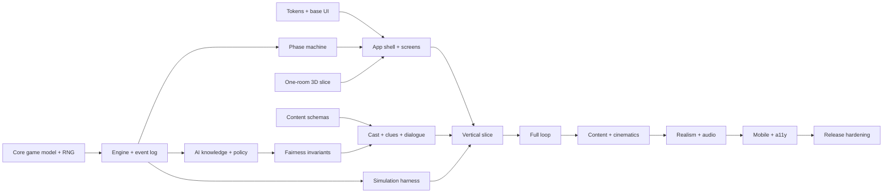

# IMPLEMENTATION PLAN — THE LAST LANTERN

> Depends on: `00-DESIGN_CANON.md` and the full document set.
> Feeds: `ACCEPTANCE_CRITERIA.md`.
> Status: **plan only.** No production code is written until the owner approves this plan
> (see the approval gate in §13).

## 1. Goal and approach

**Goal.** Ship a complete, playable vertical slice, then grow it into the baseline
12-contestant game, without ever letting the palace become a box or the AI become a cheat.

**Approach.** Build the deterministic game core and the fairness harness first, prove one
room and two AI in a vertical slice, then expand content, cast, cinematics and polish behind
hard performance and accessibility gates.

**Tech stack.** Vite 6 · React 19 · TypeScript 5 strict · three.js + react-three-fiber ·
Rapier · XState v5 · Zustand · GSAP + Lenis · Vitest + fast-check + Playwright · IndexedDB.

## 2. Milestones

| Milestone | Outcome | Exit gate |
|---|---|---|
| **M0 Foundations** | repo, tooling, tokens, content schemas, game core skeleton | CI green; headless match runs; canon docs committed |
| **M1 Vertical slice** | title → creation → one room → two AI → one mission → one night → one vote → ending stub | playable end-to-end in a browser; invariants pass; 60 fps medium tier |
| **M2 Full loop** | 12 contestants, 4 roles, 6 nights, 3 missions, evidence board, journal, map, save/load | full match headless and in-browser; all screens reachable |
| **M3 Content** | 11 dossiers, dialogue depth, chapters 1–6, opening + 6 endings | narrative review passed; all endings reachable in simulation |
| **M4 Realism** | modular palace kit, materials, lighting, characters, audio | screenshot review passes `ART_DIRECTION.md` §14 for every room |
| **M5 Mobile & accessibility** | responsive layouts, touch controls, text-only play mode, colourblind modes | a11y and mobile gates in `ACCEPTANCE_CRITERIA.md` pass |
| **M6 Release hardening** | performance, save migration, error handling, credits, licence audit | all release gates pass; asset audit clean |

## 3. Workstreams and dependency graph

## 4. Milestone M0 — Foundations

### Task M0.1 — Repository and tooling
**Files:** create `package.json`, `tsconfig.json`, `vite.config.ts`, `eslint.config.js`,
`.prettierrc`, `.gitignore`, `.github/workflows/ci.yml`.
**Produces:** `npm run dev|build|typecheck|lint|test|test:e2e|size`.
- [ ] Initialise Vite + React + TS strict; add the test and lint toolchains.
- [ ] Write a smoke test `tests/unit/smoke.test.ts` that fails until an `add(a,b)` util exists.
- [ ] Implement `src/lib/math.ts::add` and make the smoke test pass.
- [ ] Run `npm run typecheck && npm run lint && npm test` and confirm all pass.
- [ ] Commit.

### Task M0.2 — Design tokens and base styles
**Files:** `src/styles/tokens.css`, `base.css`, `motion.css`, `src/styles/README.md`.
**Produces:** the primitive/semantic token contract from `ART_DIRECTION.md` §4.
- [ ] Write a test that asserts `--color-accent` resolves to the flame token and that
  `prefers-reduced-motion` removes motion tokens.
- [ ] Implement the three token layers exactly as specified; no raw hex in components.
- [ ] Add a lint rule that fails on raw hex outside `tokens.css`.
- [ ] Commit.

### Task M0.3 — Core model and seeded RNG
**Files:** `src/game/model/*.ts`, `src/game/rng/*.ts`.
**Produces:** `Role`, `Faction`, `Contestant`, `MatchState`, `createMatch(seed)`.
- [ ] Property test: for 10 000 seeds, `createMatch(seed)` assigns exactly 3 Shadowed,
  1 Keeper, 1 Warden, 7 Oathkeepers, and the player occupies exactly one seat.
- [ ] Property test: identical seed ⇒ identical initial state.
- [ ] Implement the model and the PRNG; no `Math.random()`.
- [ ] Commit.

### Task M0.4 — Engine and event log
**Files:** `src/game/engine/reducer.ts`, `events.ts`, `log.ts`.
**Produces:** `apply(state, event) -> state`, `replay(seed, inputLog) -> MatchState`.
- [ ] Test: an `EXAMINE` event produces exactly one `CLAIM`/`CLUE` addition and no role leak.
- [ ] Test: `replay` is byte-identical for the same inputs.
- [ ] Implement the reducer as a pure function.
- [ ] Commit.

### Task M0.5 — Phase machine
**Files:** `src/game/machines/matchMachine.ts`.
**Produces:** XState machine for `dawn → day → dusk → council → night → judgment → …`.
- [ ] Test: an impossible transition (e.g. `day → night`) is rejected.
- [ ] Test: a full night cycles back to `dawn` with the correct Lantern delta.
- [ ] Implement the machine with guards reading only `MatchState`.
- [ ] Commit.

### Task M0.6 — Content schemas
**Files:** `src/game/content/schemas.ts`, `characters.ts`, `clues.ts`, `missions.ts`.
**Produces:** Zod schemas + the 11 dossiers and clue definitions from the docs.
- [ ] Test: every character validates against the schema; a missing field fails.
- [ ] Test: clue weights and tells are present for every clue.
- [ ] Implement schemas and seed content for the slice (2 characters, 4 clues, 1 mission).
- [ ] Commit.

### M0 exit gate
`npm run typecheck && npm run lint && npm test` green; a headless match reaches `day` from
a seed; the docs and CI are committed.

## 5. Milestone M1 — Vertical slice

**Slice definition (must all be true at the end):** from the title screen, the player creates
a contestant, watches a short prologue, walks the **Aangan**, talks to **Kabir** and **Tara**,
plays the **Archive Ledger** mission, votes at **Council** (including a tie path), reaches
**Night 1**, performs or observes a Veil, sees the **Judgment of the Flame**, and reaches a
stub ending — in one browser session.

### Task M1.1 — App shell and screen router
**Files:** `src/app/App.tsx`, `ScreenRouter.tsx`, `src/ui/screens/*`.
- [ ] Test: the router shows the title screen by default and can be navigated by keyboard.
- [ ] Implement the router with one screen at a time and focus restoration.
- [ ] Commit.

### Task M1.2 — Title, settings and creation screens
**Files:** `src/ui/screens/Title`, `Settings`, `Creation`.
- [ ] RTL test: creation requires a name and an oath; the primary action is disabled until
  valid; keyboard-only path works.
- [ ] Implement against `UI_SCREEN_SPEC.md` S02, S04, S05.
- [ ] Commit.

### Task M1.3 — One-room 3D slice (Aangan)
**Files:** `src/three/scenes/Palace.tsx`, `rooms/Aangan.tsx`, `Player.tsx`, `Lighting.tsx`.
- [ ] Playwright smoke: the canvas mounts, the player moves with WASD, and a screenshot at
  1440 differs from black.
- [ ] Implement the grey-box Aangan with collision (Rapier), one baked look, the Lantern, and
  a door to the Gallery stub.
- [ ] Screenshot review against `ART_DIRECTION.md` §14; fix the top three issues.
- [ ] Commit.

### Task M1.4 — HUD and examine mode
**Files:** `src/ui/hud/*`, `src/three/interactions/Examine.ts`.
- [ ] Test: the Lantern Meter renders value, state word and shape; it never relies on colour.
- [ ] Implement HUD S07 and examine mode S08; add the **cut seal** clue.
- [ ] Commit.

### Task M1.5 — Conversation with two AI
**Files:** `src/ai/*`, `src/ui/screens/Conversation`.
- [ ] Test: Kabir answers a whereabouts question from his own observation only; changing a
  fact he did not witness does not change his answer.
- [ ] Test: Tara's answer cites a claim she actually holds.
- [ ] Implement the knowledge graph, planner, template verbalizer and the conversation UI;
  wire Kabir and Tara.
- [ ] Commit.

### Task M1.6 — Archive Ledger mission
**Files:** `src/three/missions/ArchiveLedger.tsx`, `src/game/missions/archiveLedger.ts`.
- [ ] Test: a correct sort yields +10 Lantern and one Testimony; a removed fragment yields
  the clean-cut tell.
- [ ] Implement the puzzle, the result screen and the clue hand-off.
- [ ] Commit.

### Task M1.7 — Night, Veil and Council
**Files:** `src/game/engine/night.ts`, `src/ui/screens/Council`, `VoteResult`.
- [ ] Test: the Warden blocks a Veil; the Shadows learn the block but not the Warden.
- [ ] Test: a locked vote cannot change after the player votes.
- [ ] Test: a tie triggers the Lantern's Riddle and a second tie costs 15 Lantern.
- [ ] Implement night resolution, council UI, vote count and the Judgment stub.
- [ ] Commit.

### Task M1.8 — Ending stub and save
**Files:** `src/save/*`, `src/ui/screens/Ending`.
- [ ] Test: save → reload → the match resumes at the same phase with the same state.
- [ ] Test: a corrupt save is preserved and offered as an export, not deleted.
- [ ] Implement IndexedDB save/load, the ending stub and the archive record.
- [ ] Commit.

### Task M1.9 — Slice verification
- [ ] Run the Playwright slice script end-to-end.
- [ ] Run 100 seeded headless matches with the invariant suite.
- [ ] Measure frame time, draw calls, JS bytes; compare with the budgets.
- [ ] Run the accessibility scan on every slice screen.
- [ ] Write a one-page vertical-slice report with screenshots and measurements.
- [ ] Commit and tag `v0.1-slice`.

### M1 exit gate
All slice tasks pass; the slice report shows 0 invariant violations, 0 serious a11y issues,
and 60 fps at the medium tier on the reference machine.

## 6. Milestone M2 — Full loop

### Task M2.1 — 12 contestants and 4 roles
- [ ] Simulation test: 100 seeds with 12 players produce legal role distributions and legal
  night resolutions.
- [ ] Wire all 11 AI into the engine and the cast UI.
- [ ] Commit.

### Task M2.2 — Six-night pacing and Lantern economy
- [ ] Property test: Lantern ∈ [0, 120] across 1 000 seeds with scripted policies.
- [ ] Tune mission and sabotage values against the simulation report.
- [ ] Commit.

### Task M2.3 — Three mission families × three variants
- [ ] Test per mission: reward, failure, tell, and Shadow objective behaviour.
- [ ] Implement Gallery of Mirrors and Cistern Locks; add the variant system.
- [ ] Commit.

### Task M2.4 — Journal, Evidence Board, Map, Dossier
- [ ] RTL tests: every tab, empty state, keyboard path and persistence across save/load.
- [ ] Implement screens S10–S13 against the spec.
- [ ] Commit.

### Task M2.5 — Full AI society
- [ ] Test: pacts are proposed, accepted, refused and betrayed according to utility.
- [ ] Test: memory callbacks occur at the specified rate and use the character profile.
- [ ] Implement pact negotiation, notes, and the council posture system.
- [ ] Commit.

### Task M2.6 — Endgame and finals
- [ ] Test: every ending is reachable in simulation; the Unlit Oath requires a double tie.
- [ ] Implement the Reckoning, Last Question, Final Vote, Unmasking and the archive ledger.
- [ ] Commit.

### M2 exit gate
A complete 12-player match is playable in-browser from title to ending; the simulation suite
passes on 1 000 seeds; every screen is reachable and keyboard-operable.

## 7. Milestone M3 — Content and narrative

- **M3.1** Write and validate all 11 dossiers, personalities and speech fingerprints.
- **M3.2** Write dialogue libraries: 12 intents × each character, with memory callbacks.
- **M3.3** Author the six chapters, the opening cinematic and the six endings.
- **M3.4** Implement the branching model and the ending calculation; test each branch.
- **M3.5** Narrative review: a blind reader checks for cultural care, tone and originality.

**Exit gate:** every chapter and ending is reachable; the narrative review passes; no dialogue
is generated by an LLM at authoring time without human review.

## 8. Milestone M4 — Realism and audio

- **M4.1** Build the 60–90-piece architecture modular kit to the kit list.
- **M4.2** Material library from CC0 scans + authored trim sheets; licence rows filled.
- **M4.3** Lighting pass: baked lightmaps per room; dynamic flame, characters and props.
- **M4.4** Character production: base mesh, 12 outfits, LODs, visemes, animation retarget.
- **M4.5** Audio: score, ambience, foley, voice; buses and ducking; accessibility cues.
- **M4.6** Look-dev: screenshot review per room at 1440 and 390; fix the top three issues
  per room; re-review once.

**Exit gate:** every room passes `ART_DIRECTION.md` §14; the asset manifest is complete and
the licence audit passes.

## 9. Milestone M5 — Mobile and accessibility

- **M5.1** Responsive layouts at 1280/768/390; touch controls; 44 px targets.
- **M5.2** Quality tiers and automatic detection; mobile 30 fps gate.
- **M5.3** Text-only accessible play mode with the full game logic and no 3D.
- **M5.4** Colourblind modes, reduced motion, text scaling, subtitle sizing, content warnings.
- **M5.5** Playwright + axe scan on every screen; fix all serious issues.

**Exit gate:** `ACCEPTANCE_CRITERIA.md` §7–§8 pass on desktop and mobile.

## 10. Milestone M6 — Release hardening

- **M6.1** Performance profiling and budget enforcement in CI.
- **M6.2** Save migration tests across schema versions; corrupt-save recovery.
- **M6.3** Error handling for WebGL loss, asset failure, audio failure, LLM failure.
- **M6.4** Credits screen, licence export, privacy statement, content warning.
- **M6.5** Release candidate playtest with the full acceptance checklist.

**Exit gate:** all release gates pass; a signed-off build is deployable as a static site.

## 11. Cut list (explicit, in priority order)

If time runs short, cut in this order — never cut the core loop, fairness or accessibility:

1. Replay variants (Two Shadows, Nine Nights, The Smoke, The Chronicler).
2. Post-game story-card image export.
3. Spectator Mode polish (keep a basic version).
4. Voice acting for all 1 500 lines (ship subtitles + synthetic placeholders in the slice).
5. Some set-dressing props and secondary rooms (Kitchen cellars, Terrace variants).
6. Extra mission variants (ship one per family).
7. LLM verbalizer entirely (templates remain).

**Never cut:** the no-omniscience invariants, the text-only play mode, the save system, the
reduced-motion path, the licence audit, or the deterministic core.

## 12. Risk register (implementation view)

| Risk | Trigger to watch | Response |
|---|---|---|
| 3D realism gap | room screenshot reads low-poly | simplify the room, improve material and lighting, use a hero prop |
| Frame time over budget | Playwright trace > 16.6 ms | reduce dynamic lights, LOD earlier, bake more |
| AI robotic | playtest reads dialogue as generated | strengthen templates, add memory callbacks, reduce repetition |
| AI omniscient | invariant test fires | fix the projection, add a regression test |
| Scope creep | a task adds a variant or a room | move it to the cut list, protect the gate |
| Save corruption | migration test fails | preserve raw data, add a migration, never delete |
| Licence gap | audit fails | replace the asset or obtain a licence before merge |
| Voice cost | line count grows | reduce to key scenes; use the template dialogue for the rest |

## 13. Approval gate and next step

**Gate.** Per the brainstorming and writing-plans skills, nothing is implemented until the
owner approves the design set and this plan. When approved, the first executable task is
**M0.1**, then the rest of M0, then M1.

**Execution choice for the owner:**

- **Subagent-driven** — a fresh subagent implements each task and a fresh reviewer checks it
  before the next begins. Most thorough; best here because the core interfaces are shared and
  a mistake in the model or the AI projection is expensive to unwind.
- **Native** — the session implements tasks itself with one review at the end. Cheapest and
  fastest; acceptable once the interfaces in this plan are stable.

**Recommendation:** subagent-driven for M0–M2 (shared interfaces, fairness invariants), then
native for M3–M6 once the factories and schemas are frozen.

**Question for the owner:** does this plan capture the intended product, and which execution
approach should be used? No code will be written before that answer.
