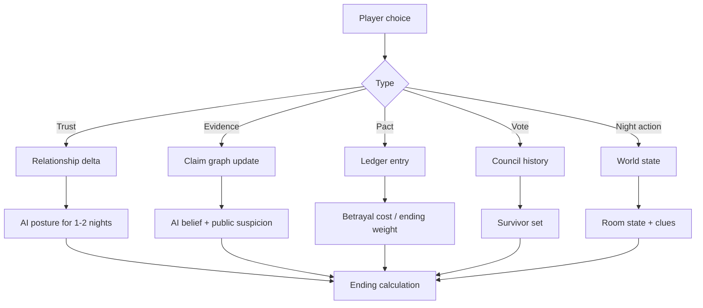

# NARRATIVE AND CHARACTERS — THE LAST LANTERN

> Depends on: `00-DESIGN_CANON.md`, `GAME_DESIGN.md`.
> Feeds: `CINEMATIC_STORYBOARD.md`, `UI_SCREEN_SPEC.md`, `ASSET_MANIFEST.md`.

## 1. Narrative spine

**Logline.** A stranger is summoned to a dying palace for the Festival of the Last Lantern;
twelve oaths are sworn to keep the flame for six nights, three of them already broken, and by
the sixth dawn only the truth will still be burning.

**Premise.** Nimbagarh has stood in the Thar for four centuries. Its founder's flame — the
Last Lantern — is said to hold the palace's fortune. Every generation, when the flame gutters,
twelve strangers are invited to keep it for six nights and earn the stewardship. This year
the invitation is strange: no names, no lineages, only an oath and a sealed room. By the first
night it is clear that something in the palace wants the flame to die, and that three of the
twelve are not who their oaths claim.

**Tone.** Desert noir. Warm sandstone and cold shadow. Hospitality with an edge of debt.
Nobody shouts; everyone remembers. The violence is absence — a room empty at dawn, a chair
pushed back, a flame lower than it was.

**Theme sentence.** *Every oath has a shadow.*

## 2. Narrative rules

1. The narrator (**Dewan Rudra Pratap**) never lies and never tells the whole truth. He
   withholds, phrases, and lets the player conclude.
2. The palace itself is a character: doors answer late, water runs when it should not, the
   jali throws a shape that is not the shape outside.
3. No supernatural explanation is confirmed. All "hauntings" have a human, physical cause
   that can be found — or remain ambiguous in the endings that choose ambiguity.
4. The player is never told their role by the narrator in a way that identifies them to
   others. The role is delivered privately in a sealed-oath card and remains personal.
5. Character arcs resolve through play. If a character is eliminated early, their arc is
   truncated honestly and their Testament becomes the payoff.
6. Real people, real brands, real show formats and real property layouts do not appear.

## 3. Chapters

The baseline game is authored as **six chapters** across the festival's maximum of six nights.
Each chapter has: a Dawn briefing, a mission set, a social weather (how tense the palace is),
two or three authored story beats, and a council. A match may resolve early through darkness,
parity, or the finale trigger; in that case the remaining chapter material is delivered in the
Unmasking and the ending epilogue, never silently dropped.

### Chapter 1 — The Summons
- **Night 1. Palace weather:** ceremony; forced politeness.
- **Beats:** arrival; the oath; the first light; the first sabotage (the archive seal is
  found cut before anyone has been named Shadowed); the first Veil is drawn on Night 1 and
  found at Dawn 2.
- **Mission set:** one tutorial mission (Archive Ledger, variant A).
- **Narrative question:** who benefits from the palace's decline?
- **If the player is Shadowed:** the night channel opens with two strangers and one shared
  silence. The tone is conspiracy, not villainy.

### Chapter 2 — The First Shadow
- **Night 2. Weather:** suspicion; whispered alliances.
- **Beats:** a contestant's private motive surfaces; the first Veil (drawn on Night 1) is found
  at Dawn 2; the Judgment of the Flame reveals the first eliminated role.
- **Mission set:** Gallery of Mirrors (variant A) + optional Cistern inspection.
- **Narrative question:** who was the last person to see the victim?
- **Branch:** whether the player shares their first Evidence determines two early AI
  alliances.

### Chapter 3 — The Broken Gallery
- **Night 3. Weather:** open factions.
- **Beats:** a red-herring clue surfaces; a Pact is offered by the contestant the player
  trusted most; the palace's mirror-work chamber reveals a hidden room.
- **Mission set:** Cistern Locks (variant A) + Archive Ledger (variant B).
- **Narrative question:** what did the palace's last steward hide?
- **Branch:** the player can choose to expose a Pact or honour it; this reshapes the endgame.

### Chapter 4 — The Archive of Ashes
- **Night 4. Weather:** grief and blame.
- **Beats:** a character's full backstory is revealed through the Archive (player-dependent
  whose story is found first); the palace's founding story is retold as a counter-narrative
  to the official one.
- **Mission set:** Gallery of Mirrors (variant B) + a night archive visit.
- **Narrative question:** whose oath is older than the festival?
- **Branch:** the player may burn a document (destroy evidence) or preserve it (risk exposure).

### Chapter 5 — The Cistern
- **Night 5. Weather:** fracture.
- **Beats:** the reservoir is either saved or lost; the palace's lower levels open; one
  surviving character's arc reaches its crisis.
- **Mission set:** Cistern Locks (variant B) + a defense of the Archive.
- **Narrative question:** what would you trade the flame for? (The Last Question, asked early
  of one contestant.)
- **Branch:** if the player is an Oathkeeper and has kept two Pacts, an ally may sacrifice
  themselves to expose a Shadow.

### Chapter 6 — The Last Lantern
- **Night 6. Weather:** silence; the last ceremony.
- **Beats:** the Reckoning; the Last Question; the Final Vote; the Unmasking; the ending.
- **Mission set:** none; the finale replaces the mission.
- **Early finale:** if the match reaches the finale before Night 6, these beats are folded into
  S21 and S22; the chapter is not skipped, only compressed.
- **Narrative question:** does the flame deserve to survive the people who kept it?

## 4. Opening cinematic (detailed)

Target length: 3 minutes 20 seconds, skippable at any time, fully subtitled, transcript in
the Journal afterwards.

| # | Time | Visual | Audio | Interaction |
|---|---|---|---|---|
| 1 | 0:00–0:14 | Black. A single flame ignites inside a brass lantern. | One breath of wind; a struck match. | none |
| 2 | 0:14–0:34 | Aerial drift over the Thar at first light; a sandstone palace resolves out of the haze. | Low strings; a distant caravan bell. | none |
| 3 | 0:34–1:00 | The gate: carved door, brass studs, an emblem that is not heraldry but a flame. | Gate groans; a voice begins. | none |
| 4 | 1:00–1:24 | The Aangan: fountain, jali light, four corridors. In the centre, the Last Lantern is lit. | Fountain; the host's first line. | none |
| 5 | 1:24–1:58 | Eleven AI portraits in the Long Gallery, each introduced by one line of voice-over and one telling gesture; the twelfth niche is the player's, left dark until the oath. | Introductions; a soft percussion under each name. | none |
| 6 | 1:58–2:22 | The oath: twelve hands, one flame, brass cups. The host explains the six nights. | Oath language; the lantern flares. | none |
| 7 | 2:22–2:46 | Night falls in one slow dissolve. A corridor light goes out. | Wind; a chair scrape. | none |
| 8 | 2:46–3:06 | Dawn. A cut seal on the archive door; a missing page; the first evidence. | Silence, then the host: "Someone has already begun." | Player gains control |
| 9 | 3:06–3:20 | Title card: THE LAST LANTERN — *Every oath has a shadow.* | Theme resolves. | Main menu or continue |

**Opening production note:** the eleven AI portraits in shot 5, plus the player's lit niche in
shot 8, are the only place all twelve appear together in a composed shot. Each portrait is a
real in-engine render of the character at their dossier pose, not a painted illustration, so
the cast's look is honest.

## 5. Character dossiers

Rules for every dossier:
- Role-independent. Nothing in a dossier, voice or appearance predicts faction.
- Each AI has **six personality axes** (0–100): Warmth, Candor, Nerve, Guile, Composure,
  Curiosity.
- Each AI has a **private motive** (role-independent), a **secret**, a **memory profile**,
  a **speech fingerprint** and a **social tendency**.
- The player can discover motives and secrets through play; discovering a secret changes the
  AI's stance and can produce major evidence.

### 5.1 Meera Rathore — the Archivist
- **Age / city:** 34, Jodhpur.
- **Personality:** Warmth 45 · Candor 80 · Nerve 55 · Guile 30 · Composure 85 · Curiosity 90.
- **Voice:** low, precise, archival. Speaks in complete sentences; corrects dates; dislikes
  rhetorical questions. Rarely raises her voice; when she does, the room stops.
- **Social tendency:** watches more than she speaks, then produces a devastating summary.
  Prefers one trusted ally to a crowd.
- **Private motive:** her family was dispossessed of a palace record that would restore their
  name. She wants the truth, even if it costs her.
- **Secret:** she once removed a page from an archive and has never forgiven herself.
- **Memory profile:** photographic recall of exact words; weak on faces in poor light.
- **Role-independent tells:** touches her left wrist when she is about to lie; organizes
  objects in threes.

### 5.2 Arjun Bhati — the Caravan Trader
- **Age / city:** 41, Jaisalmer.
- **Personality:** Warmth 80 · Candor 55 · Nerve 85 · Guile 65 · Composure 60 · Curiosity 55.
- **Voice:** warm, theatrical, folktale cadence. Uses proverbs; laughs before bad news.
- **Social tendency:** builds trust fast, spends it faster. Knows everyone's business and
  trades it as hospitality.
- **Private motive:** debt. The palace holds his father's contract and he needs it voided.
- **Secret:** he has smuggled goods along the palace road and knows a hidden gate.
- **Memory profile:** excellent on favours and debts; unreliable on times and numbers.
- **Tells:** exaggerates with his hands; goes quiet when the topic is his father.

### 5.3 Bela Sengupta — the Forensic Photographer
- **Age / city:** 27, Kolkata.
- **Personality:** Warmth 35 · Candor 90 · Nerve 60 · Guile 35 · Composure 75 · Curiosity 95.
- **Voice:** clipped, observational, dryly funny. Treats conversation as field notes.
- **Social tendency:** confronts inconsistencies immediately; makes enemies efficiently and
  allies slowly.
- **Private motive:** prove a story from her childhood about the palace is true.
- **Secret:** her camera captured something on arrival that she has not shown anyone.
- **Memory profile:** visual and spatial; remembers framing and light, not dialogue.
- **Tells:** reaches for a camera that is not there; names the light ("this is a 4 p.m. lie").

### 5.4 Kabir Mirza — the Chef
- **Age / city:** 52, Lucknow.
- **Personality:** Warmth 90 · Candor 60 · Nerve 45 · Guile 55 · Composure 80 · Curiosity 60.
- **Voice:** avuncular, metaphor-rich, food-scented. Calls people by endearments; feeds them
  before asking anything.
- **Social tendency:** the palace's social hub. Knows who ate when and who was missing.
- **Private motive:** buy back his family's ruined kitchen; the palace is his last chance.
- **Secret:** he knows the old servant network and its passwords.
- **Memory profile:** remembers meals, moods and who was absent; vague on exact hours.
- **Tells:** wipes his hands on a cloth when nervous; offers food when he is lying.

### 5.5 Zoya Sheikh — the Architect
- **Age / city:** 33, Delhi.
- **Personality:** Warmth 50 · Candor 75 · Nerve 70 · Guile 40 · Composure 70 · Curiosity 85.
- **Voice:** structured, precise, skeptical. Uses spatial language; corrects "room" to
  "volume."
- **Social tendency:** alliance-first, evidence-second. Will defend a friend past the
  evidence and then regret it publicly.
- **Private motive:** document the palace before it is sold and demolished.
- **Secret:** she has drawn unauthorized plans of the lower levels.
- **Memory profile:** map-like; remembers routes, load-bearing walls and who stood where.
- **Tells:** sketches while thinking; stops sketching when she is afraid.

### 5.6 Devendra "Dev" Chauhan — the Ex-Army Officer
- **Age / city:** 46, Dehradun.
- **Personality:** Warmth 40 · Candor 50 · Nerve 95 · Guile 60 · Composure 90 · Curiosity 45.
- **Voice:** terse, command cadence, rare dry humour. Answers questions with answers.
- **Social tendency:** tests people with small orders; trusts whoever executes cleanly.
- **Private motive:** atone for a failure that cost his unit.
- **Secret:** he was dismissed from service and the palace's guest list includes his old
  commanding officer's family.
- **Memory profile:** procedural; remembers sequence, not sentiment.
- **Tells:** checks exits twice; stands with his back to the wall.

### 5.7 Naina Vyas — the Folk Singer
- **Age / city:** 24, Barmer.
- **Personality:** Warmth 75 · Candor 65 · Nerve 70 · Guile 70 · Composure 65 · Curiosity 70.
- **Voice:** melodic, disarming, indirect. Answers with a line of a song when cornered.
- **Social tendency:** gathers people; diffuses fights; remembers who was cruel.
- **Private motive:** keep her gharana's songs from being sold to a collector.
- **Secret:** she has performed privately for someone powerful connected to the palace.
- **Memory profile:** melodic and emotional; remembers tone and feeling, not exact words.
- **Tells:** hums when she is deciding whether to lie; goes still when a song is mentioned.

### 5.8 Rohan Mehta — the Finance Broker
- **Age / city:** 31, Mumbai.
- **Personality:** Warmth 55 · Candor 45 · Nerve 65 · Guile 80 · Composure 50 · Curiosity 60.
- **Voice:** fast, persuasive, numbers. Turns every question into a trade.
- **Social tendency:** collects information and allies as assets; panics when the market turns.
- **Private motive:** escape a scandal that is one phone call from following him here.
- **Secret:** he doctored a ledger and the same hand appears in the palace archive.
- **Memory profile:** excellent on amounts and odds; poor on faces and names.
- **Tells:** taps his thumb when calculating; over-explains when afraid.

### 5.9 Ila Parekh — the Toxicologist-Botanist
- **Age / city:** 36, Ahmedabad.
- **Personality:** Warmth 45 · Candor 70 · Nerve 50 · Guile 55 · Composure 85 · Curiosity 90.
- **Voice:** quiet, exact, unsettlingly calm. Says dangerous things in the tone of a recipe.
- **Social tendency:** observes from the edge; intervenes once, decisively.
- **Private motive:** find who used her research to poison someone she loved.
- **Secret:** she recognized a poison in the palace kitchen on the first night.
- **Memory profile:** taxonomic; remembers plants, smells and dosages, not conversations.
- **Tells:** smells things; pauses before saying a name.

### 5.10 Samar Barde — the Wildlife Documentarian
- **Age / city:** 29, Goa.
- **Personality:** Warmth 65 · Candor 70 · Nerve 80 · Guile 45 · Composure 75 · Curiosity 85.
- **Voice:** laconic, observant, nature analogies. Comfortable with long silences.
- **Social tendency:** patient; waits for people to reveal themselves; a good ally in a
  crisis and a poor one in gossip.
- **Private motive:** film the truth about the palace and its last steward.
- **Secret:** his camera was recording in a room where he should not have been.
- **Memory profile:** ecological; remembers behaviour patterns and who moved like prey.
- **Tells:** watches hands, not faces; goes very still when he is recording mentally.

### 5.11 Tara Khan — the Journalist
- **Age / city:** 26, Bhopal.
- **Personality:** Warmth 60 · Candor 85 · Nerve 85 · Guile 50 · Composure 55 · Curiosity 90.
- **Voice:** direct, incisive, impatient. Asks the question everyone avoided.
- **Social tendency:** allies with the truth-tellers, alienates the comfortable.
- **Private motive:** expose a cover-up connected to the palace's ownership.
- **Secret:** her source is one of the other contestants, and she will not name them.
- **Memory profile:** quote-exact; remembers who said what and to whom.
- **Tells:** writes on her palm; leans forward when she has a source.

### 5.12 The Player — the Stranger
- **Creation choices:** name (typed), pronouns (she/her, he/him, they/them), one of six
  **Oaths** that grants a small social bonus and a private line of dialogue:
  - *I keep what I promise* (Pact trust bonus)
  - *I ask before I accuse* (Probe accuracy bonus)
  - *I watch the room* (Timeline observation bonus)
  - *I speak last* (Council composure bonus)
  - *I owe no one* (Pact resistance bonus)
  - *I remember everything* (Journal recall bonus)
- The Oath never reveals or biases the role assignment.

### 5.13 Dewan Rudra Pratap — the Host / Sutradhar
- Not a contestant, not votable, not killable.
- **Voice:** measured, poetic, courteous; the only voice that speaks in the second person.
- **Function:** explains rules, reads the vote counts, delivers Judgments, asks the Last
  Question. Never lies; withholds.
- **Design note:** the host's lines are fully authored and never generated, so tone is stable.

## 6. Voice direction and speech fingerprints

Each character has a **speech fingerprint** used by the dialogue planner as a set of
constraints, not as decoration:

| Character | Rhythm | Vocabulary | Forbidden |
|---|---|---|---|
| Meera | measured, full sentences | dates, records, "according to" | slang, exclamation |
| Arjun | rolling, proverbial | trade, weather, "my friend" | numbers, precision |
| Bela | clipped, observational | light, frame, "that's not what I saw" | sentimentality |
| Kabir | warm, circular | food, family, endearments | cruelty, hurry |
| Zoya | structured, spatial | load, span, "structurally" | vagueness |
| Dev | terse, imperative | orders, sequence, "confirm" | gossip |
| Naina | melodic, indirect | songs, seasons, "listen" | confrontation |
| Rohan | fast, transactional | odds, cost, "here's the thing" | silence |
| Ila | quiet, exact | plants, dosage, "precisely" | exaggeration |
| Samar | slow, ecological | patience, pattern, "quietly" | panic |
| Tara | direct, incisive | sources, records, "answer the question" | euphemism |
| Host | formal, poetic | oath, flame, night, "you" | modern slang |

## 7. Branching and consequence model

**Ending calculation inputs:** faction result, player survival, player faction, number of
Pacts kept vs broken, number of direct lies the player told, whether the Lantern was ever
below 20, and which AI survived to the finale.

## 8. Authored beats that must exist in the vertical slice

1. **The oath and the first light** — the prologue's final shot hands control to the player.
2. **The cut seal** — the first physical clue, found in the Archive doorway.
3. **The first conversation** — two AI (Kabir and Tara) can be questioned; their answers
   depend on what the player already knows.
4. **The first mission** — Archive Ledger, variant A, with a discoverable clean cut.
5. **The first veiling** — the player wakes to an empty room and a lowered flame.
6. **The first council** — the player speaks, votes, and sees the tally; a tie is possible.
7. **The first Judgment** — the eliminated role is revealed at the next dawn.

## 9. Content ownership and provenance

- All characters, chapters, dialogue and endings are original work for this project.
- No dialogue is copied from any television format, film, novel or game.
- Cultural terms are used respectfully and defined in an in-game glossary.
- Any real reference used in art (architecture, textiles, instruments) is listed with its
  licence in `ASSET_MANIFEST.md`; no real person's likeness or voice is used.
