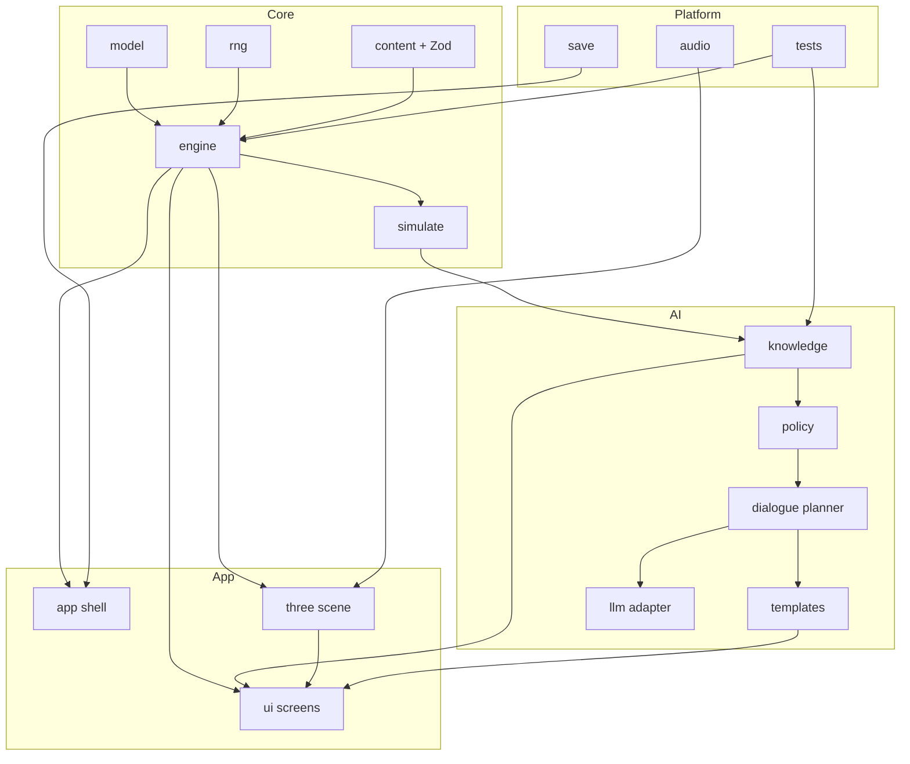

# TECHNICAL ARCHITECTURE — THE LAST LANTERN

> Depends on: `00-DESIGN_CANON.md`, `GAME_DESIGN.md`, `AI_BEHAVIOUR_SPEC.md`, `UI_SCREEN_SPEC.md`.
> Feeds: `IMPLEMENTATION_PLAN.md`, `ACCEPTANCE_CRITERIA.md`, `ASSET_MANIFEST.md`.

## 1. Constraints and environment

- The repository is currently **empty**. There is no existing framework to preserve.
- Available on the build machine: Node v24.10.0, npm 11.6.1, pnpm 9.15.9, Python 3.14.0,
  Git 2.50.1, ffmpeg, cwebp, sips, macOS 26.2, 8 GB RAM.
- Target: **browser desktop first** (Chrome, Edge, Firefox, Safari current), **responsive
  mobile second**. No server required for play; optional server only for an LLM proxy and for
  hosting static assets.
- The game must be **offline-capable after first load** and must **not require an account**.

## 2. Stack decision

| Concern | Decision | Rationale |
|---|---|---|
| Language | TypeScript 5.x, `strict: true` | one language across engine, AI, UI, content |
| Build | Vite 6 | fast HMR, static output, easy asset handling |
| UI framework | React 19 | mature ecosystem, concurrent rendering for heavy panels |
| 3D | three.js r17x + `@react-three/fiber` + `@react-three/drei` | declarative scene, real renderer control |
| Physics | `@react-three/rapier` (WASM) | robust capsule collision, triggers, movable props |
| Post-processing | `@react-three/postprocessing` (selective) | bloom only on emissive flame, vignette, grain, LUT |
| Phase machine | XState v5 | explicit, testable, inspectable day/night phases |
| UI state | Zustand + selectors | minimal re-renders; separated from the game core |
| Game core | pure TypeScript, immutable state, seeded RNG | headless tests, deterministic replay |
| Content | typed TS modules + Zod validation | one schema, validated at build and boot |
| AI | belief + utility + utterance planner; optional LLM adapter | offline, fair, bounded |
| Motion | GSAP + ScrollTrigger for story; Lenis as the only smooth-scroll engine | one engine per property |
| Audio | Web Audio API + three.js `PositionalAudio`; small mixer for UI/music | diegetic world sound, music ducking |
| Styling | CSS custom properties (three-layer tokens) + Tailwind v4 utilities | tokens are the contract; utility for layout only |
| Persistence | `idb-keyval` (IndexedDB) with versioned migrations | local-first saves, export/import JSON |
| Tests | Vitest + fast-check + React Testing Library + Playwright | unit, property, component, e2e, visual, a11y |
| CI | GitHub Actions | enforce every gate on every merge |

**Rejected:** Next.js/SSR (no SEO need, adds hydration complexity to a WebGL app), Redux
(too much ceremony for one screen at a time), Unity/Godot web export (bundle size and UI
fidelity), CSS-only fake 3D (fails the brief).

## 3. Repository layout

```
last-lantern/
├─ docs/                          # this document set (source of truth)
├─ public/
│  ├─ audio/                      # music, sfx, voice (licensed/owned)
│  ├─ models/                     # glTF/GLB, Draco/Meshopt compressed
│  ├─ textures/                   # KTX2/basis, 2K/1K/512 tiers
│  ├─ fonts/                       # Fraunces, Public Sans, subset woff2
│  └─ posters/                    # no-WebGL fallback stills
├─ src/
│  ├─ app/                        # React shell, routing between screens, providers
│  ├─ ui/                         # screens + components, one folder per screen
│  ├─ styles/                     # tokens.css, base.css, motion.css, utilities
│  ├─ game/                       # pure game core (no React, no three)
│  │  ├─ model/                   # types: Contestant, Role, Clue, Pact, Vote...
│  │  ├─ engine/                  # reducer, event log, phase transitions
│  │  ├─ machines/                # XState match machine
│  │  ├─ rng/                     # seeded PRNG + helpers
│  │  ├─ simulate/                # headless match runner + invariants
│  │  └─ content/                 # typed content + Zod schemas
│  ├─ ai/                         # knowledge graph, planner, verbalizers, policies
│  ├─ three/                      # scenes, characters, rooms, lighting, LOD
│  ├─ audio/                      # buses, emitters, music state
│  ├─ save/                       # IndexedDB, migrations, export/import
│  └─ lib/                        # small utilities (a11y, format, i18n)
├─ tests/
│  ├─ unit/                       # Vitest
│  ├─ property/                   # fast-check
│  ├─ e2e/                        # Playwright
│  └─ visual/                     # screenshot baselines
├─ scripts/                       # asset validation, licence audit, size budget
└─ .github/workflows/ci.yml
```

**Rule:** `src/game` never imports React or three. `src/three` never owns game truth; it
renders a view state. This boundary is what makes the headless simulation and the invariant
tests possible.

## 4. Game core

### 4.1 Model (core types)

```ts
type Role = 'shadowed' | 'keeper' | 'warden' | 'oathkeeper';
type Faction = 'shadowed' | 'oathkeepers';
type Phase = 'dawn' | 'day' | 'dusk' | 'council' | 'night' | 'judgment' | 'finale' | 'ending';

interface Contestant {
  id: string;
  characterId: string;   // the authored person
  role: Role;            // private
  alive: boolean;
  embers: number;
  shields: number;
  position: RoomId;
}

interface MatchState {
  seed: number;
  night: number;
  phase: Phase;
  lantern: number;              // 0..120
  contestants: Record<string, Contestant>;
  roomStates: Record<RoomId, RoomState>;
  clues: Clue[];
  claims: Claim[];
  pacts: Pact[];
  votes: Vote[];
  log: GameEvent[];             // append-only; replay source
  rngCursor: number;
}
```

### 4.2 Determinism

- All randomness flows through one seeded PRNG (`xorshift128` or `mulberry32`); no
  `Math.random()` anywhere in `src/game` or `src/ai`.
- A match is replayable from `(seed, inputLog)`. The `inputLog` is the sequence of player
  decisions and any external timing events.
- Tests assert byte-identical event logs for identical inputs.

### 4.3 Event sourcing

Every state change is a `GameEvent` appended to `log`; the reducer derives state from the log.
This gives: replay, undo-free saves, the ending's "what actually happened" archive, and the
ABILITY to diff an AI's knowledge before and after an event for the fairness test.

```ts
type GameEvent =
  | { t: 'MOVE'; contestant: string; room: RoomId }
  | { t: 'EXAMINE'; contestant: string; objectId: string; clueId?: string }
  | { t: 'CLAIM'; speaker: string; target?: string; claim: Claim }
  | { t: 'PACT'; a: string; b: string; terms: PactTerm[] }
  | { t: 'VEIL'; target: string; blocked: boolean }
  | { t: 'READ'; reader: string; target: string; result: 'shadowed' | 'oathkeeper' | 'clouded' }
  | { t: 'WARD'; warden: string; target: string }
  | { t: 'VOTE'; voter: string; target: string; shield: boolean }
  | { t: 'ELIMINATE'; target: string }
  | { t: 'JUDGMENT'; target: string; role: Role }
  | { t: 'LANTERN'; delta: number; reason: string };
```

### 4.4 Phase machine

XState owns the phase graph; the pure reducer owns the effects of each event. The machine's
guards read only from `MatchState`. This keeps the "when" separate from the "what".

## 5. AI subsystem

- `src/ai/knowledge.ts` — knowledge graph, update rules, decay.
- `src/ai/policy.ts` — candidate actions + utility scoring + bounded noise.
- `src/ai/shadow.ts` — Shadow coordination negotiation.
- `src/ai/dialogue/planner.ts` — `UtterancePlan` construction.
- `src/ai/dialogue/templates.ts` — baseline verbalizer.
- `src/ai/dialogue/llmAdapter.ts` — optional LLM verbalizer behind an interface.
- `src/ai/simulate.ts` — headless match runner and invariant checks.

The AI reads a **view** of the match derived by `projectFor(contestantId)`, which contains
only what that contestant could know. This is the single choke point that enforces fairness
and is the subject of the no-omniscience invariant test.

## 6. Rendering and 3D

### 6.1 Scene graph

```
<App>
  <ScreenRouter>            # React; one screen at a time
  <Canvas>                  # persistent three.js canvas
    <PalaceScene>           # rooms, portalled
      <Room id="aangan"> ...
      <Room id="gallery"> ...
    <Characters>            # LOD + animation mixers
    <Lighting>              # baked + dynamic
    <PostProcessing>        # bloom, vignette, grain, LUT
    <Player />              # capsule + camera rig
```

- **Room streaming:** the palace is 14 zones. A zone loads when its portal is within view or
  the player is one room away; it unloads behind. Each transition is masked by the door iris.
- **Occlusion:** per-room portal culling; colonnades and jali screens are natural occluders.
- **Instancing:** repeated kit modules (arches, brackets, screens) use `InstancedMesh`.
- **Characters:** LOD0/LOD1/LOD2 with hysteresis; skinned mesh count on screen capped.
- **Lighting:** baked lightmaps for static geometry; dynamic lights only for the flame,
  characters and moving props; shadows on one key light per room, 1024 mobile / 2048 desktop.
- **Post:** bloom limited to emissive flame materials; a single LUT; grain static; no SSAO on
  mobile.

### 6.2 Quality tiers

| Tier | DPR | Shadows | Post | Textures | Characters |
|---|---|---|---|---|---|
| High | ≤ 1.75 | PCFSoft, 2048 | bloom + vignette + grain + LUT | 2K | LOD0/1 |
| Medium | ≤ 1.5 | PCF, 1024 | bloom + LUT | 1K | LOD1/2 |
| Low | 1.0 | baked only | LUT | 512 | LOD2 + billboards |
| Fallback | — | — | — | — | static poster + text access mode |

Tier is chosen by GPU capability probe, `navigator.deviceMemory`, `hardwareConcurrency`, and
a short runtime benchmark; the player may override it in Settings.

## 7. Performance budgets (hard gates)

| Metric | Desktop | Mobile |
|---|---|---|
| Frame time | ≤ 16.6 ms (60 fps) | ≤ 33.3 ms (30 fps) |
| Initial JS (gzip) | ≤ 900 KB | ≤ 700 KB |
| First playable | ≤ 6 s on a good connection | ≤ 10 s |
| Total first-load assets | ≤ 3 MB before the palace streams | ≤ 2 MB |
| Textures in view | ≤ 80 MB VRAM | ≤ 32 MB |
| Draw calls | ≤ 250 | ≤ 140 |
| Visible triangles | ≤ 1.5 M | ≤ 500 K |
| Lights per room | ≤ 4 dynamic | ≤ 2 dynamic |
| Shadow map | 2048 | 1024 |
| Audio voices | 24 | 12 |

Budgets are enforced by a `scripts/size-budget.mjs` check in CI and a Playwright trace on the
vertical slice. A regression fails the build.

## 8. Asset pipeline

1. **Model** in Blender to the modular grid (`ARCHITECTURE_REFERENCE.md` §6).
2. **UV + bake**; author lightmap UVs; bake AO and curvature.
3. **Export** GLB; apply Draco (geometry) and KTX2/Basis (textures); generate LODs with
   Blender's Decimate or manual reduction; measure triangles and draw calls.
4. **Validate** against a schema: `scripts/validate-assets.mjs` checks naming, scale, LODs,
   texture sizes, compression and licence fields.
5. **Manifest** every asset in `ASSET_MANIFEST.md` with source, licence, author, URL and a
   credit line; `scripts/license-audit.mjs` fails CI if an asset lacks a licence.
6. **Stream** by zone; preload the next zone on a low-priority scheduler.

## 9. Audio architecture

- **Buses:** master → music / sfx / voice / ambience; per-bus volume and ducking.
- **World sound:** `three.js PositionalAudio` for emitters (fountain, flame, doors, voice in
  the cistern); distance and occlusion are approximated with a simple low-pass by zone.
- **Music:** a small state machine keyed to phase and Lantern state; crossfades are short
  (1.5–3 s) and never restart mid-scene.
- **UI sound:** short, dry, brass and cloth; no loud stings.
- **Accessibility:** every audio emitter has a visual cue; subtitles cover speech and
  important effects; audio never carries unique information.
- **Unlock:** audio starts on first user gesture; a visible mute is always available.

## 10. State, save and data

- **Save unit:** one `MatchState` + the `inputLog` + a save schema version + metadata.
- **Storage:** IndexedDB via `idb-keyval`; one key per save slot plus an archive index.
- **Migrations:** each save carries `schemaVersion`; a migration chain upgrades old saves. A
  save that cannot be migrated is preserved and offered as an export rather than deleted.
- **Autosave:** after each phase transition and after each council; manual save in Day, Dusk
  and Council only.
- **Export/import:** JSON download/upload for power users and for bug reports; no server.
- **Privacy:** no telemetry by default; opt-in, anonymous, and documented in Settings.

## 11. Error handling and resilience

| Failure | Behaviour |
|---|---|
| WebGL unavailable | fallback poster + full accessible text mode; game logic still playable |
| WebGL context lost | pause, attempt restore, else fallback; save is never lost |
| Asset load failure | retry with backoff; a missing non-critical asset degrades to a placeholder tone, never a crash |
| Corrupt save | preserve the raw data, offer export, start a new game; never silently delete |
| Audio failure | game continues; captions remain |
| LLM adapter failure | silent fallback to templates |
| Invariant violation | clamp the AI action, log a bug report payload, continue; never crash the match |

## 12. Testing strategy

- **Unit (Vitest):** reducer, phase machine, RNG, knowledge update, utility scoring, save
  migration, formatting.
- **Property (fast-check):** invariants from `GAME_DESIGN.md` §16 and
  `AI_BEHAVIOUR_SPEC.md` §10.2; e.g. "for any seed and any input log, Lantern ∈ [0,120]".
- **Component (RTL):** every screen renders, keyboard order, empty states, focus management.
- **E2E (Playwright):** one full vertical-slice match; a tie; a WebGL fallback boot; a save/
  load round-trip; an accessibility scan on every screen.
- **Visual (Playwright screenshots):** the Aangan at three times of day, the council, the
  evidence board, the ending card, at 1440/768/390.
- **Performance (Playwright trace + custom metrics):** frame time, draw calls, JS heap,
  asset bytes; compared against §7.
- **Simulation (headless):** 1,000 matches per CI run (reduced to 100 on PRs) with the
  invariant suite.

## 13. CI pipeline

```
install → typecheck → lint → unit + property → build → size budget →
license audit → e2e (vertical slice) → visual diff → a11y scan → report
```

- Fail the build on: type errors, lint errors, failing tests, size-budget breach, missing
  asset licence, a11y violations at the "serious" level, visual diff above threshold.
- Nightly: the full 1,000-match simulation and a performance trace on the reference machine.

## 14. Security and integrity

- No secrets in client code. Any LLM key lives on an optional proxy, never in the bundle.
- Content Security Policy: no `eval`, no remote script, images/fonts from self, connect only
  to the optional proxy.
- LLM output is treated as untrusted text: validated, length-capped, escaped, and never
  rendered as HTML.
- Save import is schema-validated and size-capped before parsing.
- No user accounts, no PII, no tracking by default.

## 15. Biggest technical risks and mitigations

| # | Risk | Likelihood | Impact | Mitigation |
|---|---|---|---|---|
| 1 | 3D realism gap ("looks low-poly") | High | Critical | vertical slice proves one room; modular kit + licensed PBR scans + baked light; honest stylised-real target |
| 2 | Performance on mid-range laptops | High | High | budgets enforced in CI; quality tiers; occlusion; instancing; mobile fallback |
| 3 | AI feels omniscient or robotic | Medium | Critical | `projectFor` choke point; invariant tests; simulation harness; template quality bar |
| 4 | Scope explosion (12 cast, 6 chapters) | High | High | slice-first milestones; the full cast is not a prerequisite for the slice |
| 5 | Save/state complexity | Medium | High | event-sourced core; versioned migrations; export before delete |
| 6 | LLM cost/latency/safety | Medium | Medium | off by default; adapter; cache; schema-bound; template fallback |
| 7 | Legal/provenance | Medium | Critical | manifest + licence audit in CI; no show assets or celebrity likeness |
| 8 | Audio/voice production | Medium | Medium | scoped lines; original score; synthetic or contracted voice with licence |
| 9 | Cinematic quality bar | Medium | Medium | animatics first; in-engine; shared LUT; skip/transcript |
| 10 | Accessibility depth | Medium | High | text-only play mode designed from the start, not retrofitted |

## 16. Module dependency map



## 17. Definition of done for the technical foundation

- `src/game` runs headless in Node with zero React/three imports.
- A seeded match can be simulated, logged and replayed to a byte-identical log.
- Every invariant test passes for 1,000 seeds.
- The three.js canvas renders the Aangan at the medium tier within budget.
- Every screen is reachable and keyboard-operable.
- CI is green with all gates above.
