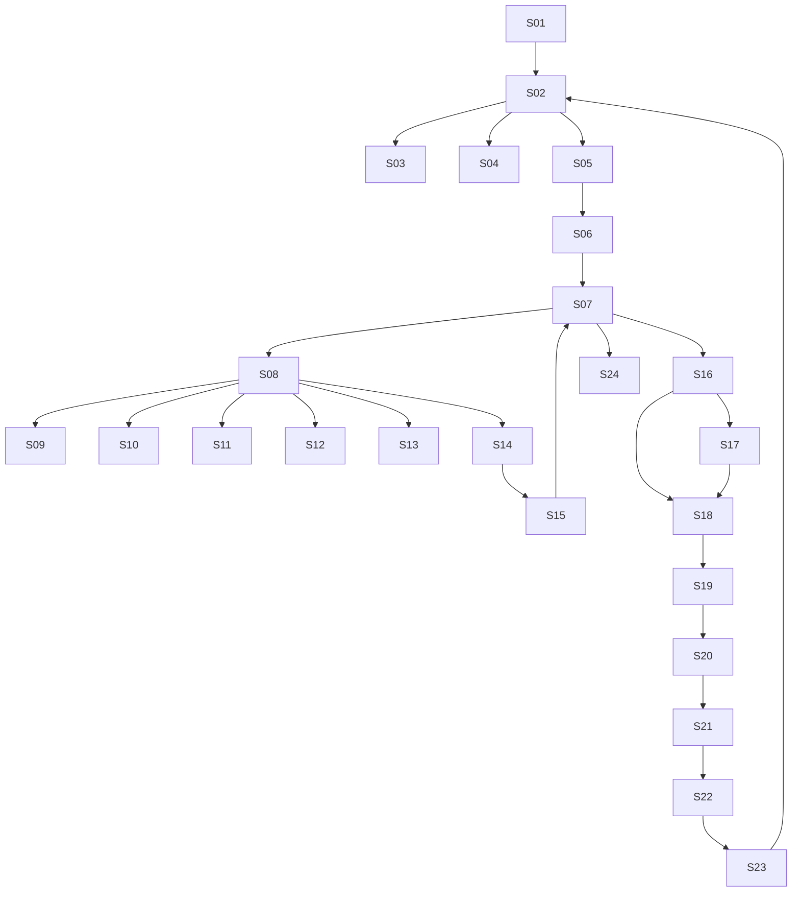

# UI SCREEN SPEC — THE LAST LANTERN

> Depends on: `00-DESIGN_CANON.md`, `ART_DIRECTION.md`, `GAME_DESIGN.md`.
> Feeds: `TECHNICAL_ARCHITECTURE.md`, `ACCEPTANCE_CRITERIA.md`.

## 1. UI principles

1. **Diegetic where possible.** The Journal is a book on the player's table; the Evidence
   Board is a board in the player's room; the Map is an architect's plan; the HUD is a brass
   instrument. Menus are cinematic; play surfaces are quiet and precise.
2. **One accent, one action.** Each screen has one primary action in flame; everything else
   is ivory, tone steps and text.
3. **No generic dashboard.** Cards, gradient blobs, glass, hairlines, index numbers and
   icon-topped feature rows are banned. Bounded regions use tone fields or architectural
   frames.
4. **Keyboard-first, controller-friendly later.** Every action is reachable with Tab, arrows,
   Enter/Space and Escape. No pointer-only interaction.
5. **State is legible without colour.** Faction is never hue-coded; roles, votes and outcomes
   carry shape and text.
6. **Motion is interruptible.** Nothing blocks input; every animation can be skipped or
   reduced.

## 2. Screen inventory

| # | Screen | Type | Primary action | Keyboard |
|---|---|---|---|---|
| S01 | Boot / Preloader | cinematic | wait / skip | Esc skips |
| S02 | Title Menu | cinematic | New Game | arrows, Enter |
| S03 | Continue / Archive list | app | Load | arrows, Enter, Del |
| S04 | Settings | app | apply | Tab, arrows, Enter |
| S05 | Contestant Creation | cinematic + form | Swear the Oath | Tab, Enter |
| S06 | Prologue Cinematic | cinematic | continue | Esc skip |
| S07 | Palace HUD | overlay | interact | context keys |
| S08 | Exploration | play | move / examine | WASD, E, Tab |
| S09 | Conversation | app-overlay | choose intent | arrows, Enter |
| S10 | Journal | app | turn page / pin | arrows, Enter, P |
| S11 | Evidence Board | app | link / inspect | arrows, Space, L |
| S12 | Character Dossier | app | read / compare | arrows, Enter |
| S13 | Palace Map | app | filter / route | arrows, Enter |
| S14 | Mission Interface | play | act | context keys |
| S15 | Mission Result | app-overlay | continue | Enter |
| S16 | Night Action (role) | cinematic-overlay | confirm | arrows, Enter |
| S17 | Shadow Channel | app (Shadowed only) | choose / coordinate | arrows, Enter |
| S18 | Council | cinematic | speak / vote | arrows, Enter |
| S19 | Vote Result / Judgment | cinematic | continue | Enter |
| S20 | Testament / Memory | cinematic | continue | Enter |
| S21 | Finale / Unmasking | cinematic + app | step / finish | arrows, Enter |
| S22 | Ending | cinematic | continue | Enter |
| S23 | Archive / Post-game | app | filter / export | arrows, Enter |
| S24 | Pause / Save | app-overlay | resume / save | Esc |

## 3. Global chrome

- **Top-left:** context title (room or screen) in Fraunces `h2`; never a logo wall.
- **Top-right:** Lantern Meter (rosette + number + state word), time-of-day glyph, and the
  settings button. The meter is visible on every play surface.
- **Bottom-centre:** interaction prompt in Public Sans `caption`, e.g. `E · Examine the seal`.
- **Bottom-left:** Journal, Evidence Board, Map, Dossier rail (four buttons, labelled).
- **Bottom-right:** the player's own status. The role is private: a sealed-oath card opens to
  name the player's role and night action, and is never shown on a shared surface.
- **Dialogue:** the speaker's name and portrait jharokha on the left; text centre; intents in
  a vertical list on the right; evidence attachment at the bottom.
- **Safe areas:** `env(safe-area-inset-*)` on all full-bleed screens.

## 4. Screen specifications

### S01 Boot / Preloader
- **Layout:** black field; a single flame grows in a brass lantern at centre; a thin
  progress indication is the flame's height, not a bar.
- **Text:** title in Fraunces `display-2` appears only after assets are ready; loading text
  ends with `…`.
- **Failure:** if WebGL is unavailable, show a still frame of the Aangan with a plain message
  and a link to the accessibility mode (storyboards + journal, no 3D).
- **Reduced motion:** static flame, numeric percentage.

### S02 Title Menu
- **Layout:** full-bleed in-engine shot of the Aangan at dusk, camera slowly drifting. The
  menu is a single vertical list at the left third, not a centred card.
- **Items:** New Game · Continue · Archive · Settings · Accessibility · Credits · Quit.
- **Type:** items in Fraunces `h2` when focused, Public Sans `body-lg` otherwise; a brass
  weight marker sits left of the focused item.
- **Background:** real rendered scene, no video file, no gradient overlay; a flat low scrim
  only where text sits.
- **Motion:** flame flicker (pausable), slow camera drift; reduced motion freezes both.

### S03 Continue / Archive
- **Layout:** a ledger of saves: date, night, cast thumbnail row, ending (if any), seed.
- **Value:** `New Game`, `Continue`, `Import JSON`, `Export JSON`, `Delete`.
- **Empty state:** a written line — "No lantern has been lit yet." — with a New Game action.
- **Rules:** destructive delete requires a confirm dialog; undo window is not available for
  saves, so the confirm is explicit.

### S04 Settings
Groups: **Display** (quality tier, brightness, LUT strength, grain), **Audio** (master, music,
SFX, voice, subtitle language), **Motion** (reduce motion, camera shake, flame flicker),
**Accessibility** (text size, colourblind mode, subtitles, transcript, untimed day, guided
mode, cognitive difficulty), **Controls** (rebind, invert Y, sensitivity), **Data** (seed
display, export save, privacy statement).
- Every control has a visible label; sliders show a numeric value; toggles are real switches
  with `aria-pressed`.
- Changes apply live where possible; a "Restore Defaults" action sits at the bottom of each
  group.

### S05 Contestant Creation
- **Layout:** a jharokha window at centre; the player's portrait is a live in-engine head that
  updates with choices. Left: name and pronouns. Right: six Oaths, each a single line with a
  small carved seal.
- **Fields:** name (text, `autocomplete="off"`, `spellcheck="false"`), pronouns (radio group),
  oath (radio group, one required), difficulty (segmented), seed (optional, advanced).
- **Validation:** empty name defaults to "The Stranger" with a note, never an error wall.
- **Primary action:** `Swear the Oath`, disabled only while the name field is focused-empty.

### S06 Prologue Cinematic
- Full-bleed; skip, pause, subtitles, transcript; chapter card at the end; hand-off to S07.

### S07 Palace HUD
- Minimal overlay: top-right Lantern Meter and time; bottom-centre prompt; bottom-left rail;
  no minimap unless opened.
- **Lantern Meter states:** Radiant (120–101), Burning (100–70), Guttering (69–40), Failing
  (39–20), Ember (19–1), Dark (0). Each has a word, a shape and a number. Radiant is the only
  state that can grant the public-truth boon, once per match, from Dawn 2 onward.
- **Notifications** use `aria-live="polite"` and never cover the prompt.

### S08 Exploration
- **Controls:** WASD/arrows move, mouse look (pointer lock optional), `E` interact, `Tab` cycle
  interactables, `Shift` walk, `Esc` pause. Mobile: left thumbstick, right drag look, tap to
  interact.
- **Interaction:** a jharokha-shaped reticle changes state when an object is examinable;
  prompt names the object in plain words.
- **Examine mode:** close-up on the object with a written description, an "Add to Evidence"
  action when relevant, and a drawn detail if the object is small.
- **Door transitions:** door iris 500 ms, then the room streams behind a jali mask.

### S09 Conversation
- **Layout:** three columns — speaker (portrait, name, mood), dialogue history (scrollable,
  newest at bottom), intents (vertical list). Below: evidence attachment strip.
- **Intents:** Ask whereabouts · Probe opinion · Share evidence · Accuse · Defend · Confide ·
  Promise/Pact · Deceive · Threaten · Console · Leave.
- **Evidence attachment:** choose one Evidence or Testimony; the AI reaction is authored from
  the claim graph, never generated freely.
- **Pact UI:** a draft with terms as checkboxes; both parties see a seal when agreed; the Pact
  Ledger records it.
- **History:** every line is a ledger row with speaker, time and a truth dot (the player's
  own notes only, not engine truth).
- **Keyboard:** Up/Down to move intents, Enter to select, `1–9` quick-select, `Esc` to leave.

### S10 Journal
Tabs: **Oaths** (the player's oath and active pacts), **Notes** (free text and auto-notes),
**Timeline** (events and claims with times), **People** (dossiers), **Glossary** (cultural
terms and rules), **Chapter** (current objective and summary).
- The Journal is a book: a two-page spread on desktop, a single page on mobile; page-turn
  motion 300 ms, reduced to a cut.
- Search filters timeline and people. Pinning a note adds it to the Evidence Board.

### S11 Evidence Board
- A horizontal board with movable nodes and drawn links. Node types: Evidence, Testimony,
  Person, Room, Cipher. Link types: supports, contradicts, places, suspects.
- **Interaction:** select node with arrows, link with `L`, inspect with Enter, remove with
  Delete (confirm only if the node is linked).
- **Truth display:** the board shows *the player's* connections only. It never marks a clue
  true or false, because the player does not know.
- **Assist:** an optional "Tidy" action arranges nodes by type; it changes no meaning.
- **Export:** the final board is included in the ending's archive.

### S12 Character Dossier
- Jharokha-framed portrait, name, city, six personality axes as a small carved bar set (not a
  radar chart cliché — a horizontal bar with a mark), public timeline, known claims, and the
  player's own notes.
- **Compare mode:** two dossiers side by side; differences in claims are highlighted with a
  margin mark, never with colour alone.
- **Role section:** only fills in after death/reveal or at the finale.

### S13 Palace Map
- An architectural line plan (ink on parchment tone) with room states: lights, water, damage,
  doors, and known clue markers.
- Filter chips: `Rooms`, `Clues`, `People last seen`, `Sabotage`.
- Selecting a room shows a one-line state and, if known, who was last seen there.
- The map is not a route-finder; it is a memory aid. Fast-travel is not available.

### S14 Mission Interface
- **Layout:** left third — objective, role chip, Lantern projection; centre — the puzzle
  surface; right third — participants and their contribution, plus the timer if timed.
- **Shadow objective:** shown as a private optional line for Shadowed players, phrased as a
  mission step: "Optional: remove the damaged fragment before the seal."
- **Cooperation:** callouts appear as speech bubbles over participants; the player can call a
  contribution; AI respond according to personality.
- **Failure:** the mission outcome screen explains what was lost and what tell remains.

### S15 Mission Result
- One dominant figure (the ledger, inscription or water level) plus three lines: Lantern
  change, Embers earned, Evidence gained. No card grid.
- Continue returns to the room; a "Review" action opens the relevant Journal entry.

### S16 Night Action
- Role-specific screens share one composition: a dark field, a single flame, a row of living
  contestant tokens, and a confirm action. Each screen names the action in the player's
  language, never in role jargon.
- **Keeper:** "Read the Flame" — choose a token; result is a private card with the word
  *Shadowed* or *Oathkeeper* and a carved disc.
- **Warden:** "Ward" — choose a token; disallowed targets are visibly unavailable with a
  reason ("You warded them last night.").
- **Shadowed:** opens S17.
- **Oathkeeper:** a quiet reflection screen with an optional intention for quick-resolve.

### S17 Shadow Channel
- Only for Shadowed players. A dark, intimate room: three brass tokens, a shared board, and a
  coded hand-sign palette (a small set of icons: veil, ward suspicion, exchange, wait).
- **Conversation:** free text is allowed here only between humans in a future multiplayer; in
  single-player, the two AI Shadows send structured proposals and the player chooses.
- **Decision:** on Veil nights (1, 3, 5), pick a Veil target and optionally one Sabotage; on
  Vigil nights (2, 4), pick one Sabotage only. Confirm; the screen closes.
- **Fairness:** the player never sees the Keeper's or Warden's private action.

### S18 Council
- **Layout:** the round table seen from above at a slight angle; one position per contestant,
  covered by cloth when eliminated; the Lantern at the centre. The active speaker is in the
  only lit column; others are in tone step down, never blurred.
- **Floor turns:** the order is shown as a brass ring of names; the player's turn highlights.
- **Speech composer:** choose an intent (accuse, defend, present evidence, question, silent),
  an optional evidence attachment, and up to two sentences from authored openers. The
  composed line is read by the player character; AI respond.
- **Vote:** each token is a brass disc; the player drags/keys a name; the count is locked;
  then the discs drop one by one.
- **Tie:** the *Lantern's Riddle* card with a 30-second re-vote among tied names.
- **Keyboard:** arrows move between speakers; Enter opens the composer; `V` opens voting.

### S19 Vote Result / Judgment
- **Vote result:** discs fall, names are read, the covered chair is revealed.
- **Judgment of the Flame:** the role disc turns; text names the role; the Lantern Meter
  updates. Reduced motion: two static frames and a text line.

### S20 Testament / Memory
- The eliminated contestant speaks; the text is a claim, not necessarily truth. The player may
  add it to the Evidence Board as a Testimony. A memory flashback plays if the contestant had
  a discovered secret.

### S21 Finale / Unmasking
- **The Reckoning:** one testimony per survivor, authored.
- **The Last Question:** the host's question and each answer, as portraits.
- **The Final Vote:** same council UI with all shields revealed.
- **Unmasking:** an interactive ledger of roles, votes, pacts, lies and the player's choices.
  The player steps through it at their own pace; nothing autoplays.

### S22 Ending
- Full-bleed cinematic, then a written epilogue with the Oath Ledger (promises kept and
  broken), the final vote, and one closing line. Continue returns to S02; an Export action
  saves a story card image and a JSON record.

### S23 Archive / Post-game
- A ledger of past games: seed, cast, roles, survivors, votes, pacts, ending, duration.
- Filters: ending, survival, role, cast member.
- Actions: replay with same seed, replay with same cast, export record, delete.

### S24 Pause / Save
- Pause dims the world (tone step, not blur) and shows: Resume · Journal · Settings · Save ·
  Accessibility · Quit to Title.
- Save is available in Day, Dusk and Council phases; not during a cinematic or a mission
  outcome, to keep the game state clean. The button is disabled with a written reason when
  unavailable.

## 5. Typography, tokens and component rules

- All UI references semantic tokens from `ART_DIRECTION.md` §4; no raw hex in components.
- One accent per screen; danger used once; focus ring is always visible.
- Buttons are flat and square; the only round shapes are rosettes, tokens and the Lantern.
- Tables and ledgers may use real rules; everything else separates by tone.
- Text size and subtitle size are user-adjustable; layouts reflow to 390px without horizontal
  scroll.
- Long content truncates with an ellipsis; flex children carry `min-w-0`; empty states are
  written, never blank.

## 6. Responsive behaviour

| Breakpoint | Layout |
|---|---|
| ≥ 1280 | full three-column play surfaces; two-page Journal; side-by-side dossiers |
| 768–1279 | two columns; Journal single page; evidence board scrolls horizontally |
| 390–767 | one column; bottom tab rail; conversation becomes a full-screen sheet; council uses a vertical list with a pinned vote bar |
| < 390 | not supported; a written notice and the storyboard mode |

Mobile-specific:
- Touch targets ≥ 44 px; 8 px minimum spacing.
- `touch-action: manipulation`; no double-tap zoom delay.
- Left thumbstick for movement, right drag for look, tap for interact.
- The Lantern Meter collapses to a numeric ring in the top-right.
- Cinematics are always skippable; subtitles default on.

## 7. Accessibility specification

- **Keyboard:** every screen reachable in a logical tab order; visible focus; no traps; skip
  link to main content on app screens; `Esc` closes overlays and returns focus to the
  invoking control.
- **Screen reader:** app screens are semantic HTML with headings, lists, tables and labels.
  Play surfaces expose a parallel, text-only "Accessible Play" mode that presents the same
  information and choices without requiring 3D navigation.
- **Reduced motion:** all travel removed; transitions cut; flame static; parallax and camera
  drift off; the state is still conveyed numerically.
- **Colorblind:** three palettes; faction never hue-coded; shapes and labels everywhere.
- **Hearing:** subtitles for all speech and sound effects, transcripts, visual equivalents for
  every audio clue, no audio-only mechanics.
- **Cognitive:** cognitive difficulty setting; guided mode; untimed day; a rules glossary;
  "remind me" button in the Journal; no timed reading in dialogue.
- **Motor:** no precision aiming; hold-to-walk alternatives; remappable keys; no rapid-tap
  requirements; mission puzzles have a "assist" completion option that costs Lantern.
- **Photosensitivity:** no strobe, no flash > 3 Hz, no full-screen high-contrast flicker.
- **Content:** a content warning before the first cinematic (themes of betrayal, disappearance,
  confinement); pause menu always available.
- **Localisation:** strings externalised; `Intl.DateTimeFormat` and `Intl.NumberFormat`;
  cultural terms kept with a glossary; `translate="no"` on proper names and code.

## 8. Screen flow diagram

## 9. Acceptance criteria for the UI

1. Every screen in §2 exists, is reachable, and has a written empty state.
2. No screen uses a banned device from `ART_DIRECTION.md` §15.
3. Every interactive element is keyboard reachable with visible focus.
4. Every screen renders at 1440, 768 and 390 without horizontal scroll.
5. Every play surface has an accessible text-only equivalent.
6. Every screen passes the contrast, shape-label and reduced-motion checks.
7. The Journal, Evidence Board and Map persist across saves and are exported in the archive.
